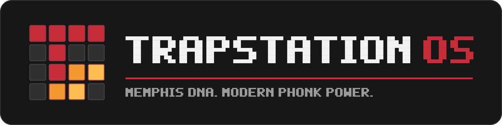
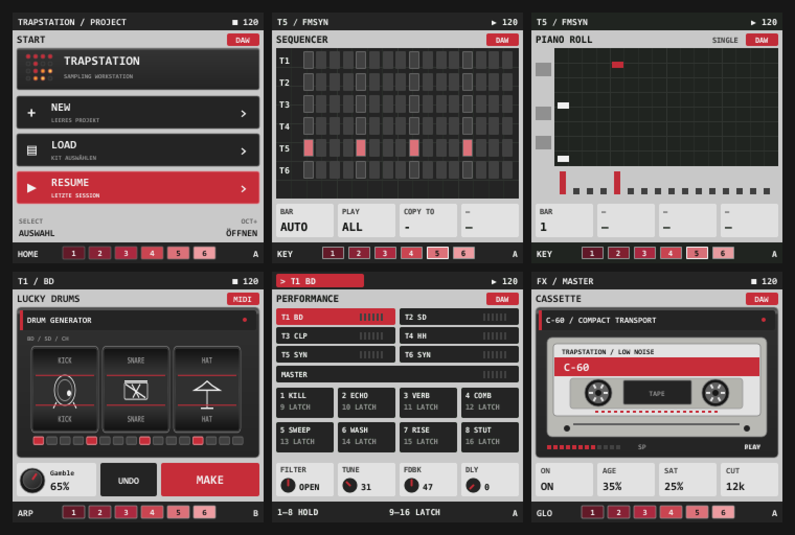
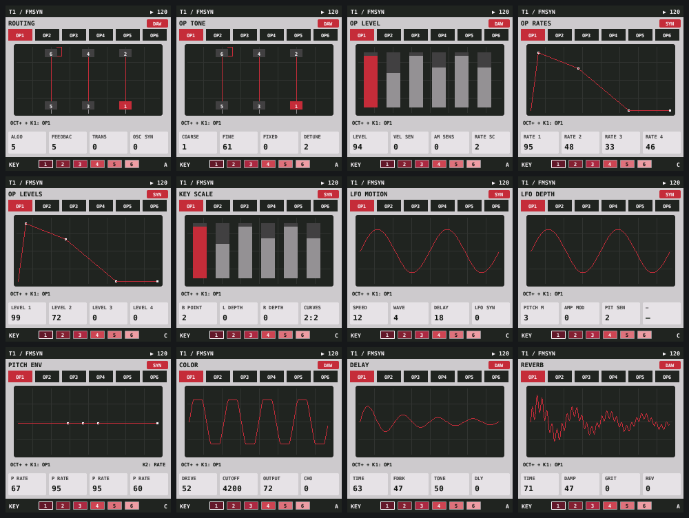
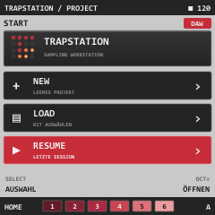
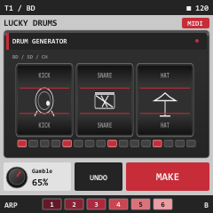
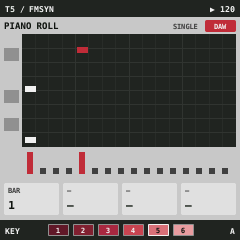
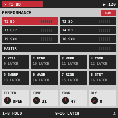
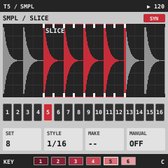
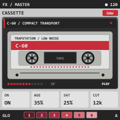

<p align="center">
  
</p>

<p align="center"><b>Eine Trap- und Phonk-Groovebox-Firmware für den M-VAVE FM-1</b><br>
808s mit Druck und Glide, FM-Keys und Bells, Generatoren für Drums, Hi-Hats, Bass und Akkorde, ein Sampler mit Slices
und eine Live-Performance-Seite</p>

<p align="center">
  <a href="https://github.com/sog-maker/trapstation-os/releases/latest"></a>
  <a href="LICENSE"></a>
  
  <a href="https://sog-maker.github.io/trapstation-os/"></a>
</p>

<p align="center"><b>Neu in 1.1.0.0:</b> eine neue FM-Engine mit sechs Operatoren, 22 überarbeitete Keys, Bells, Orgeln,
Pads und Leads, zwölf neue Sound-Seiten, Undo und eine überarbeitete Desktop-App · <a href="#neu-in-1100">was neu ist</a> ·
<a href="https://github.com/sog-maker/trapstation-os/releases/tag/v1.1.0.0">die Release-Notes</a> · <a href="README.md">English</a></p>

<p align="center"><b>Neu bei TRAPSTATION?</b> Lies die <a href="docs/manual/de/Trapstation-Guide-DE.pdf">Anleitung</a>
(<a href="docs/manual/en/Trapstation-Guide-EN.pdf">English</a>) und leg dir den
<a href="docs/cheatsheet/Trapstation-Cheat-Sheet.pdf">Spickzettel</a> neben das Gerät.<br>
<b>Am Computer:</b> <a href="https://github.com/sog-maker/trapstation-desktop">Trap Station Desktop</a> macht aus Audiodateien
Samples, bearbeitet die FM6-Sounds, spiegelt den Bildschirm und exportiert deine Jam nach Ableton Live.</p>



TRAPSTATION OS macht den FM-1 zur Sechs-Spur-Groovebox für Trap, Phonk und Memphis Rap: 808-Maschinen mit Glide und
Sub, FM-Keys, Bells, Orgeln, Pads und Leads in fünf fertigen Bänken und ein Sampler für eigene Sounds. Vier
Jackpot-Generatoren werfen mit einem Regler neue Drums, Hi-Hats, Basslines und Akkorde aus, und jedes Ergebnis bleibt
normale Noten, die du in der Piano Roll bearbeitest. Die PERFORMANCE-Seite legt jede Spur, ihren Mute und acht
Effekt-Würfe unter deine Finger. Jede Seite zeichnet, was ihre Regler tun, in einem einheitlichen rot-grauen
Workstation-Design.

TRAPSTATION OS ist freie Software, ein Fork von [BBL JAM BOX](https://github.com/UnkleBlairy/BBL-JAM-BOX) von Blair, das
auf [Felucca](https://github.com/hugelton/Felucca) von Hügelton Instruments aufbaut. Es ist weder BBL JAM BOX noch
Felucca: Fehler bitte [hier](https://github.com/sog-maker/trapstation-os/issues) melden.

## Neu in 1.1.0.0

- **Eine neue Engine.** FM SYN ist jetzt **FM6**: sechs Operatoren, 32 Algorithmen, für jeden Operator eine Hüllkurve
  aus vier Raten und vier Pegeln, ein LFO und eine Pitch-Hüllkurve, dazu DRIVE, CUTOFF und OUTPUT, um jede Spur zu
  färben. Sie ersetzt den Synth mit vier Operatoren. Die Spuren teilen sich sechzehn FM-Stimmen, bis zu sechs auf einer.
- **Überarbeitete Presets.** Die 22 Keys, Bells, Orgeln, Pads und Leads der Bänke A–E sind auf der neuen Engine neu
  gebaut: dunkler, voller, mit klarerem Anschlag und Ausklang. Drei haben neue Namen: GHOST VOICES, DARK FLUTE und
  DUSTY KOTO. 808s, Drums, MONO-Sounds und der Sampler klingen genau wie vorher.
- **Zwölf Sound-Seiten** für FM SYN im Workstation-Design: ROUTING, OP TONE und OP LEVEL auf **FX**; OP RATES,
  OP LEVELS und KEY SCALE auf **SCL**; LFO MOTION, LFO DEPTH und PITCH ENV auf **ENV**; COLOR, DELAY und REVERB auf
  **LFO**. **OCT+** halten und **K1** drehen wählt den Operator. Eine gehaltene Note folgt jedem Regler sofort.
- **Undo.** **OCT-** zweimal tippen: Die letzte Reglerbewegung oder der zuletzt geladene Sound oder Pattern wird
  zurückgenommen.
- **Schneller.** Der Start dauert eine halbe Sekunde, und eine Szene wechselt in dem Moment, in dem du sie lädst.
- **Eine überarbeitete Desktop-App.** [Trap Station Desktop 0.2.0](https://github.com/sog-maker/trapstation-desktop) dreht
  sich um einen Sound-Editor für die neue Engine: Er spielt über die Sound-Engine der Firmware selbst, die Tasten des
  FM-1 spielen den Sound, den du gerade bearbeitest, und DX7-Stimmen lassen sich importieren und exportieren.



**Vor dem Update von 1.0.0.0:** erst im Installer sichern. Samples, eigene Sounds und Kits bleiben auf dem FM-1. Die
letzte Jam von 1.0.0.0 lädt 1.1.0.0 nicht (die Jam enthält jetzt die FM6-Sounds), der FM-1 startet also mit einer
frischen. Ein FM6-Sound wird mit der Jam gespeichert: Solange eine Spur einen spielt, speichern und laden die eigenen
Sound-Plätze und die Kits nicht (auf dem Bildschirm steht `FM6: USE PROJECT SAVE`).

## Installieren

Eigene Firmware, auf eigenes Risiko; der Weg zurück zur offiziellen Firmware steht unten.

**Im Browser** (Chrome oder Edge am Computer): den [TRAPSTATION-Installer](https://sog-maker.github.io/trapstation-os/) öffnen, den FM-1
per USB anschließen, **1. Firmware installieren · sichern** wählen und den Schritten folgen. Zuerst sichern: Dieselbe
Seite speichert Sounds, Kits, die letzte Jam und die Samples in eine Datei und spielt sie wieder zurück.

**Über The Firmware Hub:** TRAPSTATION ist bei [thefirmwarehub.com](https://thefirmwarehub.com/) eingereicht; der Hub
installiert Firmwares mit einem Klick und wechselt zwischen ihnen.

**Mit Python 3:** `trapstation-os-1.1.0.0.fwsc` aus dem [aktuellen Release](https://github.com/sog-maker/trapstation-os/releases/latest)
laden und mit dem Ordner `tools/` dieses Repos:

```
pip install mido python-rtmidi
python tools/fm1_install.py trapstation-os-1.1.0.0.fwsc
```

**Verbinden:** ein USB-**Daten**kabel, direkt am Computer (kein Hub, Dock oder Monitor-Anschluss), andere Musikprogramme
geschlossen. Am Computer heißt der FM-1 **TRAPSTATION FM-1**; in der DAW ist er ein normales USB-MIDI-Gerät.

**Für den besten Klang:** Auf der Seite CLOCK den 4. Regler (CPU) nach rechts drehen und den FM-1 aus- und einschalten:
Der zweite Kern ist an (Anzeige 2CPU), mit mehr Reserve für Effekte.

**Zurück zur offiziellen Firmware:** im Installer **Zurück zur offiziellen V15** mit M-VAVEs `FM-1_015.fwsc` (aus dem
[fm1_open-Repository](https://github.com/m-vave/fm1_open)) oder M-VAVEs eigener Updater. TRAPSTATION bringt seinen
Update-Loader mit, deshalb übernehmen auch der Firmware Hub und die Installer anderer Firmwares.

**Werkszustand:** Im Installer löscht **Sichern und Werkszustand herstellen** deine eigenen Sounds, Kits, Samples und
die letzte Jam (nach einer Sicherung); die Werksbänke und die zwei Werks-Kits bleiben.

Schritt für Schritt, und was tun, wenn etwas schiefgeht: [INSTALL.de.md](INSTALL.de.md) · [English](INSTALL.md).

## Auf einen Blick

| | |
| --- | --- |
| **Spuren** | 6, jede mit eigener Maschine, eigenem Sound, eigenen Steps und Mix, dazu eine FX-Spur für die Master-Effekte |
| **Maschinen** | 808-Kit-Maschinen (Kick, Snare, Clap, Hat, Cowbell, Perc) mit Glide, Sub und Accent; 8BAS 808-Bass; FM SYN (FM6: 6 Operatoren, 32 Algorithmen); MONO; DIGITAL; SAMPLER |
| **Sounds** | fünf Werksbänke: A Memphis, B Drift Phonk, C Jazz Phonk, D Chill / Lo-Fi, E Wave; zwei Werks-Kits, MEMPHIS 808 und DR660 KIT; 16 eigene Sounds je Maschine, 11 eigene Kits |
| **Sequencer** | 64 Steps je Spur (4 Bars), Akkorde, Ties, Accents, Rolls, Parameter-Locks, Trig-Bedingungen; K2 PLAY wiederholt eine Bar live, K3 COPY TO kopiert eine Bar auf eine andere, für alle Spuren |
| **Generatoren** | LUCKY DRUMS, ACE HATS, LOW ROLLER, GOLDEN CHORDS: ein GAMBLE-Regler, MAKE und UNDO; CHORD GEN, CHORD VAR, QUICK FILL und EUCLID |
| **Piano Roll** | die Noten der Bar im Raster; OCT+ + K1 wählt ganze Akkorde oder einzelne Noten, K2 verschiebt, K3 ändert die Tonhöhe, K4 die Länge; die Tasten klingender Noten leuchten |
| **Sampler** | bis zu 32 Samples (etwa 11 s); PITCH, STRETCH, START, LEN; ONCE, LOOP, PING, REV; SLICE: bis zu 16 Slices im Raster oder getippt, gespielt über die weißen Tasten |
| **Performance** | alle Spuren im Blick; schwarze Tasten muten sofort, Tasten 8–11 springen zwischen den Bars; acht Effekt-Würfe (KILL, ECHO, VERB, COMB, SWEEP, WASH, RISE, STUT), gehalten oder eingerastet; vier Mute-Szenen, die auf dem Takt wechseln |
| **Effekte** | Delay, Reverb, Comb, DJ-Filter, AMP; die Texturen TAPE C-60, VHS E-180 und VINYL |
| **Speicher** | Sounds, Kits und Samples im Flash; die letzte Jam kommt beim Einschalten zurück (RESUME) |
| **Installer** | im Browser: installieren, sichern, wiederherstellen, Samples hochladen, Werkszustand, zurück zu V15 |
| **Hardware** | jeder FM-1, auch die neueren Geräte mit dem Flash-Chip UC25HQ80; optional der zweite Kern |

## Eine Tour

### Eine Jam starten

<table>
<tr>
<td width="40%"><br><sub><b>Die Studio Console</b> nach dem Pad-Logo</sub></td>
<td>

1. **Einschalten.** Das Pad-Logo leuchtet auf, dann bietet die Studio Console **NEW**, **LOAD** und **RESUME**.
2. **SELECT** wählt, **OCT+** öffnet: NEW startet ein neues Projekt mit MEMPHIS 808, LOAD wählt ein Kit, RESUME holt die
   letzte Jam zurück.
3. **ALGORITHM** wählt die Spur, **PRESETS** ihre Maschine. Eine Seitentaste halten und **SELECT** drehen öffnet das
   Menü der Seite.

</td>
</tr>
</table>

### Würfeln: die Generatoren

<table>
<tr>
<td width="40%"><br><sub><b>LUCKY DRUMS</b>: Walzen für Kick, Snare und Hat</sub></td>
<td>

1. Die Wiedergabe **stoppen** und **ARP** öffnen: LUCKY DRUMS, ACE HATS, LOW ROLLER und GOLDEN CHORDS stehen
   nebeneinander.
2. **K1 GAMBLE** bestimmt, wie wild es wird (0–100).
3. **K4 nach rechts** fordert MAKE an, **OCT+** bestätigt: Ein neues Pattern landet auf den Spuren, mit eigener kurzer
   Animation.
4. Gefällt nicht? **K3 UNDO** holt das vorige zurück. Alles, was ein Generator schreibt, bleiben normale, bearbeitbare
   Steps.

</td>
</tr>
</table>

### Noten bearbeiten: die Piano Roll

<table>
<tr>
<td width="40%"><br><sub><b>PIANO ROLL</b> im Modus SINGLE</sub></td>
<td>

1. Auf einer Synth-Spur **HOME › PIANO ROLL** öffnen. **SELECT** wählt die Bar.
2. **OCT+ halten + K1:** rechts **SINGLE** (einzelne Noten), links **CHORD** (ganze Akkorde). Oben rechts steht der
   Modus.
3. **K1** springt von Akkord zu Akkord bzw. Note zu Note, **K2** verschiebt, **K3** ändert die Tonhöhe, **K4** die Länge.
4. Die Tasten links leuchten rot für die Noten, die klingen. QUICK FILL funktioniert genauso.

</td>
</tr>
</table>

### Live spielen: PERFORMANCE

<table>
<tr>
<td width="40%"><br><sub><b>PERFORMANCE</b>: alle Spuren, acht Würfe</sub></td>
<td>

1. **Schwarze Tasten 1–6** muten eine Spur sofort und ganz aus dem Mix. **Schwarze Tasten 8–11** springen zu Bar 1–4;
   dieselbe Taste noch einmal spielt wieder das ganze Pattern.
2. **Weiße Tasten 1–8** werfen einen Effekt, solange gehalten, **9–16** rasten ihn ein: KILL, ECHO, VERB, COMB, SWEEP,
   WASH, RISE, STUT.
3. **OCT+ + schwarze Taste** wählt den Kanal für die Effekte; schwarze Taste 7 ist der MASTER.
4. **K1** FILTER, **K2** TUNE, **K3** FDBK, **K4** der Delay-Send.

</td>
</tr>
</table>

### Ein Sample zerschneiden

<table>
<tr>
<td width="40%"><br><sub><b>SLICE</b>: Schnitte im Raster oder getippt</sub></td>
<td>

1. Samples über die Installer-Seite **2. Samples laden** aufs Gerät bringen (oder mit der Desktop-App).
2. Auf einer SAMPLER-Spur schaltet **OCT+ + K1** die Reglersätze durch: PITCH / STRCH / START / LEN, dann MODE / SLOT /
   LOFI / LEVEL, dann GATE / SCRUB. **OCT+ halten + K2** probiert einen Abspielmodus, solange gehalten.
3. Auf **SLICE**: **K1 SET** die Zahl der Slices, **K2 STYLE** das Raster, **K3** nach rechts MAKE. Oder **K4 MANUAL**
   und die Schnitte auf den weißen Tasten tippen, während das Sample läuft.
4. Weiße Taste n spielt Slice n: von den Tasten, aus dem Sequencer, aus den Generatoren.

</td>
</tr>
</table>

### Den Master färben

<table>
<tr>
<td width="40%"><br><sub><b>TAPE C-60</b>: die Spulen drehen sich beim Abspielen</sub></td>
<td>

- **TAPE C-60:** ON, AGE, SAT, CUT. **VHS E-180:** Wow und Flutter. **VINYL:** Rauschen, Staub, Knistern, Abnutzung.
- **DELAY** und **REVERB** auf der FX-Spur, gespeist von den Sends jeder Spur; **COMB**, der **DJ**-Filter und **AMP**
  auf dem Master.
- **SCENES** speichern vier Mute-Zustände; LOAD zeigt die nächste sofort auf den Tasten und wechselt auf dem nächsten
  Takt.

</td>
</tr>
</table>

Alle Bildschirme des Designs, alle 154 Ansichten: [docs/design](docs/design/).

## Bedienung

| Element | Was es tut |
| --- | --- |
| **ALGORITHM** | wählt die Spur (1–6, dann die FX-Spur) |
| **PRESETS** | die Maschine der Spur; **HOME + PRESETS** öffnet den Preset-Browser |
| **SELECT** | die eigene Wahl der Seite (Bar, Szene, Fill-Typ …); Seitentaste halten + SELECT: das Menü der Seite |
| **REGLER 1–4** | die vier Wertekarten unten auf dem Bildschirm |
| **Seitentasten** | FX, SCL, ENV, LFO, GLO, EDIT, HOME, ARP: ein Tippen öffnet die zuletzt gezeigte Seite, ein weiteres die nächste |
| **SAVE** | gehalten + Taste speichert einen Sound (weiße Tasten) oder ein Kit (schwarze Tasten); kurz tippen lädt |
| **PLAY / REC** | Transport und Aufnahme |
| **OCT− / OCT+** | Oktave; OCT+ gehalten ist die Umschalttaste (Piano-Roll-Modus, Sampler-Sätze, Effektkanal) |

Die vollständige Liste, Seite für Seite: die [Anleitung](docs/manual/de/USER_GUIDE.md) und der
[Spickzettel](docs/cheatsheet/Trapstation-Cheat-Sheet.pdf).

## Desktop-App

[**Trap Station Desktop**](https://github.com/sog-maker/trapstation-desktop) für Windows arbeitet neben dem Installer:

- **Converter:** WAV, MP3, FLAC, OGG, M4A, AIFF und mehr in Samples für den FM-1.
- **Sampler S01–S32:** fügt Samples hinzu, ohne die vorhandenen zu löschen.
- **Sound-Editor:** die Werks-Presets der Bänke A–E und eigene Sounds, mit den zwölf FM6-Seiten, beim Bearbeiten
  hörbar über die Sound-Engine der Firmware selbst; DX7-Stimmen und -Bänke (`.syx`) rein und raus.
- **Geräteansicht:** der FM-1, gezeichnet um seinen Live-Bildschirm; seine Tasten spielen den Sound im Editor.
- **Arrangement und Ableton-Export:** die vier Szenen als Clips, Piano Roll und Drum-Editor, dazu ein Ableton-Live-Projekt
  (`.als`) oder MIDI-Dateien deiner Jam.

## Dokumentation

| | Deutsch | English |
| --- | --- | --- |
| Installation | [INSTALL.de.md](INSTALL.de.md) | [INSTALL.md](INSTALL.md) |
| Anleitung (PDF, mit Designatlas) | [Trapstation-Guide-DE.pdf](docs/manual/de/Trapstation-Guide-DE.pdf) | [Trapstation-Guide-EN.pdf](docs/manual/en/Trapstation-Guide-EN.pdf) |
| Anleitung (Web) | [USER_GUIDE.md](docs/manual/de/USER_GUIDE.md) | [USER_GUIDE.md](docs/manual/en/USER_GUIDE.md) |
| Schnellstart | [QUICKSTART.md](docs/manual/de/QUICKSTART.md) | [QUICKSTART.md](docs/manual/en/QUICKSTART.md) |
| Performance-Seite | [PERFORMANCE.md](docs/manual/de/PERFORMANCE.md) | [PERFORMANCE.md](docs/manual/en/PERFORMANCE.md) |
| Die FM6-Sound-Seiten (neu in 1.1) | [FM6.md](docs/manual/de/FM6.md) | [FM6.md](docs/manual/en/FM6.md) |
| Spickzettel | [Trapstation-Cheat-Sheet.pdf](docs/cheatsheet/Trapstation-Cheat-Sheet.pdf) | |
| Designreferenz | [docs/design](docs/design/) | |
| Änderungen | [CHANGELOG.md](CHANGELOG.md) | |

## Selbst bauen

Unter Linux x86-64 oder Ubuntu in WSL, mit der JieLi-Toolchain und dem AC79-SDK:

```
tools/get_toolchain.sh
git clone --depth 1 --branch AC79NN_SDK_V1.2.1_2023-12-13 https://gitee.com/Jieli-Tech/fw-AC79_AIoT_SDK.git ~/fw-AC79_AIoT_SDK
./build.sh --release 1.1.0.0
```

Der Tag `v1.1.0.0` baut das veröffentlichte Paket bytegleich. Alles Weitere, auch der lokale und der Online-Installer:
[docs/developer](docs/developer/).

## Wenn der FM-1 nicht startet

- **Der Installer ist mittendrin stehen geblieben:** den FM-1 eingeschaltet lassen, USB abziehen, wieder einstecken und
  noch einmal **Installieren** klicken. Der Update-Loader macht dort weiter, wo er aufgehört hat.
- **Update-Modus von Hand:** **OCT−** und **OCT+** zusammen halten, bis UPDATE MODE herunterzählt; dann neu installieren.
- **Gar nichts startet:** Die Rettung braucht den [FM-1-transporter](https://github.com/kurogedelic/FM-1-transporter).
  Deshalb nie abziehen, solange der Installer schreibt.

## Hilfe

Einen Fehler gefunden? Ein [Issue](https://github.com/sog-maker/trapstation-os/issues) eröffnen: die Version, was du getan hast, was du
erwartet hast und was passiert ist, und was der Bildschirm oder der Installer zeigte. Ein Foto hilft.

## Credits

- **[BBL JAM BOX](https://github.com/UnkleBlairy/BBL-JAM-BOX)** von **Blair** (blairysbeatlab): die Firmware, auf der
  TRAPSTATION aufbaut: der Groovebox-Workflow, die 808-Maschinen, der Sampler und sein Uploader, DJ-Filter und Comb, das
  Speichern von Sounds und Kits, und die Schrift BLB Pixel 7 Chunky ([SIL OFL 1.1](LICENSES/OFL-BLBPixel7.txt))
- **[Felucca](https://github.com/hugelton/Felucca)** von **[Hügelton Instruments](https://hugelton.com)** (Leo Kuroshita,
  [@kurogedelic](https://github.com/kurogedelic)): das Fundament: Hardware-Schicht des FM-1, USB, Update-Loader und
  Installer, Sequencer, Effekte und Bildschirm-Code; Engine-Schnittstelle und DSP-Helfer aus
  [Felucca-Engines](https://github.com/hugelton/Felucca-Engines) ([MIT](LICENSES/MIT-Felucca-Engines.txt)) und die
  Icon-Schrift [Fukiai](https://github.com/hugelton/Fukiai) ([MIT](LICENSES/MIT-Fukiai.txt))
- **[Skiff](https://github.com/illuminus5/skiff)** von [illuminus5](https://github.com/illuminus5): Chord Follow
  (Grundton-Erkennung), der FM6-Kern in Ganzzahl-Rechnung, auf dem FM SYN dieser Firmware läuft, und eine Inspiration
  für Browser-Editor, Presets und Spur-Aufbau
- **msfa**, der Synthese-Kern von [Dexed](https://github.com/asb2m10/dexed) (Google Inc., Pascal Gauthier): die
  FM6-Engine, im Ganzzahl-C-Port von Leo Kuroshita ([Apache-2.0](LICENSES/Apache-2.0-msfa.txt))
- **[FM1-X0X](https://github.com/charlesvestal/fm1-x0x)** von [charlesvestal](https://github.com/charlesvestal): eine
  Inspiration für den 808-Fokus und den Accent, dazu Start, Mailbox und Schutz des zweiten Kerns
- Zweiter Kern: nach [Melodee](https://github.com/keremimo/melodee) von [keremimo](https://github.com/keremimo) und
  [Jangada](https://github.com/zednaked/jangada) von [zednaked](https://github.com/zednaked) (GPL-3.0)
- Schrift: [Inter Tight](https://github.com/rsms/inter-tight) von The Inter Project Authors ([SIL OFL 1.1](LICENSES/OFL-InterTight.txt))
- Rettung: [FM-1-transporter](https://github.com/kurogedelic/FM-1-transporter) von Leo Kuroshita; Hardware-Referenz:
  M-VAVEs [fm1_open](https://github.com/m-vave/fm1_open)
- Paketformat und Boot-Dateien: [JieLi AC79 SDK](https://gitee.com/Jieli-Tech/fw-AC79_AIoT_SDK) ([Apache-2.0](LICENSES/Apache-2.0.txt);
  drei seiner Dateien stecken in jedem Paket, keine in diesem Repo)
- Feluccas Mitwirkende: keremimo, ChanceTheMaker, andreahaku, spinkham, ugai, zednaked, jasonpersinger, renebohne,
  gospodindilly-ops
- Die FM-1-Community rund um [The Firmware Hub](https://thefirmwarehub.com/)

Alle Sounds von TRAPSTATION sind synthetisiert oder selbst gemacht. Details: [CREDITS.md](CREDITS.md).

## Lizenz

Freie Software: [GPL-3.0-only](LICENSE). TRAPSTATION OS ist eine veränderte Fassung von BBL JAM BOX und Felucca. Die
mitgelieferten Schriften und die Teile aus Felucca-Engines behalten ihre eigenen Lizenzen ([LICENSES/](LICENSES/));
Details in [LICENSING.md](LICENSING.md). Name, Logo und Artwork von TRAPSTATION stehen nicht unter der GPL.

M-VAVE und FM-1 sind Marken ihrer jeweiligen Inhaber. TRAPSTATION OS ist mit ihnen nicht verbunden und wird von ihnen
nicht unterstützt, ebenso wenig von Blair oder Hügelton Instruments.

Copyright (C) 2026 Leo Kuroshita (@kurogedelic), Hügelton Instruments (Felucca)<br>
Copyright (C) 2026 Blair (blairysbeatlab) (BBL JAM BOX)<br>
Copyright (C) 2026 Schlensog Audio Lab (TRAPSTATION OS)
