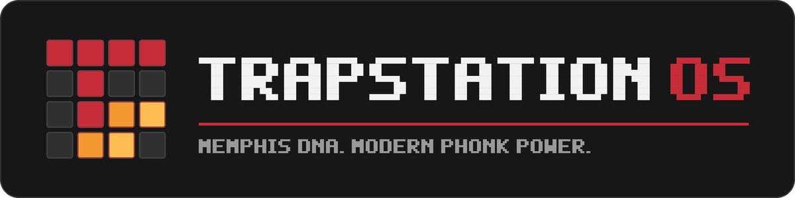
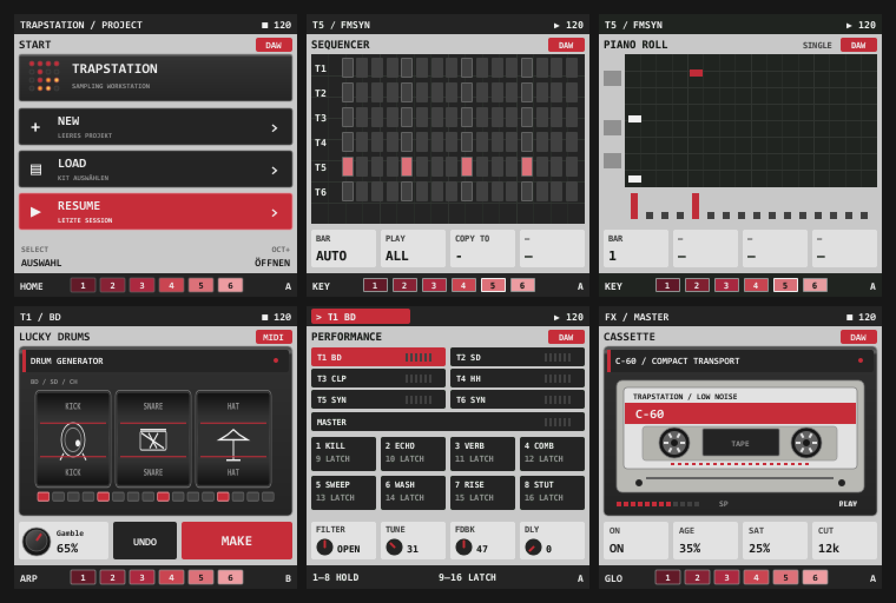
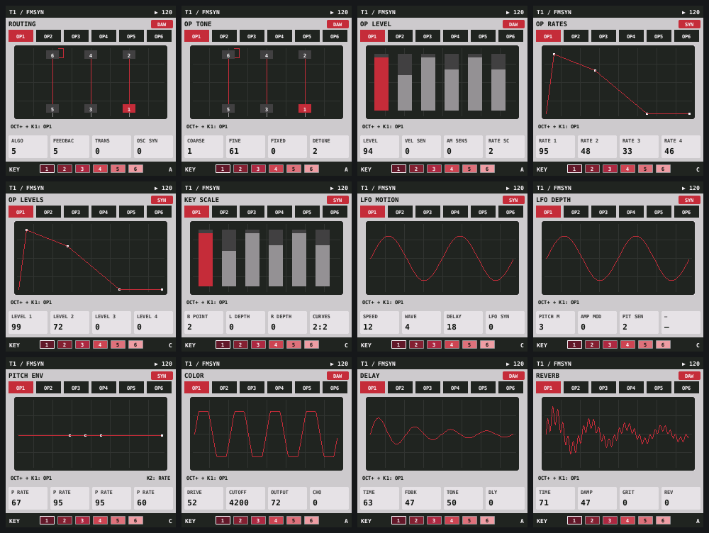
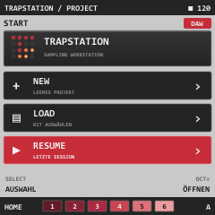
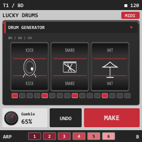
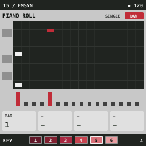
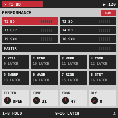
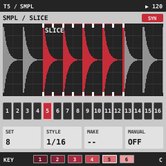
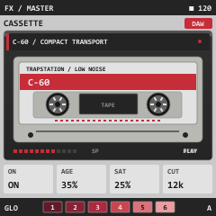

<p align="center">
  
</p>

<p align="center"><b>A trap and phonk groovebox firmware for the M-VAVE FM-1</b><br>
808s that boom and glide, FM keys and bells, generators for drums, hats, bass and chords, a sampler with slices and a
live performance page</p>

<p align="center">
  <a href="https://github.com/sog-maker/trapstation-os/releases/latest"></a>
  <a href="LICENSE"></a>
  
  <a href="https://sog-maker.github.io/trapstation-os/"></a>
</p>

<p align="center"><b>New in 1.1.0.1:</b> the last jam no longer fills up (`LAST JAM FULL` in 1.1.0.0): please update ·
<a href="https://github.com/sog-maker/trapstation-os/releases/tag/v1.1.0.1">the release notes</a></p>

<p align="center"><b>New in 1.1:</b> a new six-operator FM engine, 22 reworked keys, bells, organs, pads and leads,
twelve new sound pages, Undo, and a reworked desktop app · <a href="#whats-new-in-1100">what's new</a> ·
<a href="https://github.com/sog-maker/trapstation-os/releases/tag/v1.1.0.0">the release notes</a></p>

<p align="center"><b>New to TRAPSTATION?</b> Read the <a href="docs/manual/en/Trapstation-Guide-EN.pdf">user guide</a>
(<a href="docs/manual/de/Trapstation-Guide-DE.pdf">Deutsch</a>) and keep the
<a href="docs/cheatsheet/Trapstation-Cheat-Sheet.pdf">cheat sheet</a> next to the unit.<br>
<b>On a computer:</b> <a href="https://github.com/sog-maker/trapstation-desktop">Trap Station Desktop</a> turns audio files into
samples, edits the FM6 sounds, mirrors the screen and exports your jam to Ableton Live.</p>



TRAPSTATION OS turns the FM-1 into a six-track groovebox for trap, phonk and Memphis rap: 808 machines with glide and
sub, FM keys, bells, organs, pads and leads in five ready banks, and a sampler for your own sounds. Four jackpot
generators throw new drums, hi-hats, bass lines and chords at the turn of one knob, and every result stays ordinary
notes you can edit in the piano roll. The PERFORMANCE page puts every track, its mute and eight effect throws under
your fingers. Every page draws what its knobs do, in one red-and-grey Workstation design.

TRAPSTATION OS is free software, a fork of [BBL JAM BOX](https://github.com/UnkleBlairy/BBL-JAM-BOX) by Blair, itself
built on [Felucca](https://github.com/hugelton/Felucca) by Hügelton Instruments. It is not BBL JAM BOX and not Felucca:
please report its behaviour [here](https://github.com/sog-maker/trapstation-os/issues).

## What's new in 1.1.0.1

- **The last jam fits again.** In 1.1.0.0 it filled up with little more than one bar of steps on every track, the
  screen showed `LAST JAM FULL`, and from then on nothing was saved over power-off. The jam is stored packed now: six
  tracks of 64 steps, five of them FM6, take a little over half of its room. No sound changes.
- A jam of 1.1.0.0 is loaded and kept. Going back to 1.1.0.0 starts with a fresh jam.
- [Trap Station Desktop 0.2.1](https://github.com/sog-maker/trapstation-desktop) reads the new jam.

## What's new in 1.1.0.0

- **A new engine.** FM SYN is now **FM6**: six operators, 32 algorithms, an envelope of four rates and four levels for
  every operator, an LFO and a pitch envelope, and DRIVE, CUTOFF and OUTPUT to colour each track. It replaces the
  four-operator synth. Sixteen FM voices are shared by the tracks, up to six on one.
- **Reworked presets.** The 22 keys, bells, organs, pads and leads of banks A–E are rebuilt on the new engine: darker,
  fuller, with clearer attacks and tails. Three of them have new names: GHOST VOICES, DARK FLUTE and DUSTY KOTO. The
  808s, drums, MONO sounds and the sampler sound exactly as before.
- **Twelve sound pages** for FM SYN, in the Workstation design: ROUTING, OP TONE and OP LEVEL on **FX**; OP RATES,
  OP LEVELS and KEY SCALE on **SCL**; LFO MOTION, LFO DEPTH and PITCH ENV on **ENV**; COLOR, DELAY and REVERB on
  **LFO**. Hold **OCT+** and turn **K1** to choose the operator. A held note follows every knob at once.
- **Undo.** Tap **OCT-** twice: the last knob move, or the last sound or pattern you loaded, is taken back.
- **Faster.** The start takes half a second, and a scene changes the moment you load it.
- **A reworked desktop app.** [Trap Station Desktop 0.2.0](https://github.com/sog-maker/trapstation-desktop) is built around
  a sound editor for the new engine: it plays through the firmware's own sound engine, the FM-1's keys play the sound
  you are editing, and DX7 voices can be imported and exported.



**Before you update from 1.0.0.0:** back up in the installer first. Samples, user sounds and kits stay on the FM-1.
The last jam of 1.0.0.0 is not loaded by 1.1.0.0 (the jam now carries the FM6 sounds), so the FM-1 starts with a fresh
one. An FM6 sound is kept with the jam: while a track plays one, the user sound slots and the kits do not save or load
(the screen says `FM6: USE PROJECT SAVE`).

## Install

Custom firmware, at your own risk; the way back to the official firmware is below.

**In the browser** (Chrome or Edge on a computer): open the [TRAPSTATION installer](https://sog-maker.github.io/trapstation-os/),
connect the FM-1 by USB, click **1. Install the firmware · back up** and follow it. Back up first: the same page saves
your sounds, kits, last jam and samples to a file, and puts them back.

**From The Firmware Hub:** TRAPSTATION is submitted to [thefirmwarehub.com](https://thefirmwarehub.com/), which installs
firmwares in one click and switches between them.

**With Python 3:** download `trapstation-os-1.1.0.1.fwsc` from the [latest release](https://github.com/sog-maker/trapstation-os/releases/latest)
and, with this repository's `tools/` folder,

```
pip install mido python-rtmidi
python tools/fm1_install.py trapstation-os-1.1.0.1.fwsc
```

**Connecting:** a USB **data** cable, straight into the computer (no hub, dock or monitor port), other music apps closed.
On the computer the FM-1 shows up as **TRAPSTATION FM-1**; in a DAW it is a normal USB-MIDI device.

**For the best sound:** on the CLOCK page turn KNOB 4 (CPU) to the right and switch the FM-1 off and on: the second
core is on (the screen shows 2CPU), with more headroom for effects.

**Back to the official firmware:** the installer's **Return to official V15** with M-VAVE's `FM-1_015.fwsc` (from the
[fm1_open repository](https://github.com/m-vave/fm1_open)), or M-VAVE's own updater. TRAPSTATION carries its update
loader, so the Firmware Hub and other firmwares' installers take over from it too.

**Factory state:** the installer's **Back up and reset to factory state** clears your own sounds, kits, samples and
last jam (after a backup); the factory banks and the two factory kits stay.

Step by step, and what to do when something goes wrong: [INSTALL.md](INSTALL.md) · [Deutsch](INSTALL.de.md).

## At a glance

| | |
| --- | --- |
| **Tracks** | 6, each with its own machine, sound, steps and mix, plus an FX track for the master effects |
| **Machines** | 808 kit machines (kick, snare, clap, hat, cowbell, perc) with glide, sub and accent; 8BAS 808 bass; FM SYN (FM6: 6 operators, 32 algorithms); MONO; DIGITAL; SAMPLER |
| **Sounds** | five factory banks: A Memphis, B Drift Phonk, C Jazz Phonk, D Chill / Lo-Fi, E Wave; two factory kits, MEMPHIS 808 and DR660 KIT; 16 user sounds a machine, 11 user kits |
| **Sequencer** | 64 steps a track (4 bars), chords, ties, accents, rolls, parameter locks, trig conditions; K2 PLAY repeats one bar live, K3 COPY TO copies a bar onto another one on every track |
| **Generators** | LUCKY DRUMS, ACE HATS, LOW ROLLER, GOLDEN CHORDS: one GAMBLE knob, MAKE and UNDO; CHORD GEN, CHORD VAR, QUICK FILL and EUCLID |
| **Piano Roll** | the bar's notes on a grid; OCT+ + K1 picks whole chords or single notes, K2 moves, K3 changes the pitch, K4 the length; the keys of sounding notes light up |
| **Sampler** | up to 32 samples (about 11 s); PITCH, STRETCH, START, LEN; ONCE, LOOP, PING, REV; SLICE: up to 16 slices on a grid or tapped in, played from the white keys |
| **Performance** | every track at a glance; black keys mute at once, keys 8–11 jump between bars; eight effect throws (KILL, ECHO, VERB, COMB, SWEEP, WASH, RISE, STUT), held or latched; four mute scenes that change on the bar |
| **Effects** | delay, reverb, comb, DJ filter, AMP; TAPE C-60, VHS E-180 and VINYL textures |
| **Memory** | sounds, kits and samples kept in flash; the last jam comes back at power-on (RESUME) |
| **Installer** | in the browser: install, back up, restore, upload samples, reset to the factory state, return to V15 |
| **Hardware** | every FM-1, including the newer units with the UC25HQ80 flash chip; optional second core |

## A tour

### Start a jam

<table>
<tr>
<td width="40%"><br><sub><b>The Studio Console</b> after the pad logo</sub></td>
<td>

1. **Switch on.** The pad logo lights up, then the Studio Console offers **NEW**, **LOAD** and **RESUME**.
2. **SELECT** picks one, **OCT+** opens it: NEW starts a fresh project on MEMPHIS 808, LOAD picks a kit, RESUME brings
   back the last jam.
3. **ALGORITHM** selects the track, **PRESETS** its machine. Hold a page button and turn **SELECT** for that page's menu.

</td>
</tr>
</table>

### Throw the dice: the generators

<table>
<tr>
<td width="40%"><br><sub><b>LUCKY DRUMS</b>: kick, snare and hat reels</sub></td>
<td>

1. **Stop** playback and open **ARP**: LUCKY DRUMS, ACE HATS, LOW ROLLER and GOLDEN CHORDS sit side by side.
2. **K1 GAMBLE** sets how wild it gets (0–100).
3. **K4 right** asks for MAKE, **OCT+** confirms: a new pattern lands on the tracks, with its own short animation.
4. Not your groove? **K3 UNDO** brings back the last one. Everything a generator writes stays normal, editable steps.

</td>
</tr>
</table>

### Edit notes: the piano roll

<table>
<tr>
<td width="40%"><br><sub><b>PIANO ROLL</b> in SINGLE mode</sub></td>
<td>

1. Open **HOME › PIANO ROLL** on a synth track. **SELECT** picks the bar.
2. **OCT+ held + K1:** right for **SINGLE** (single notes), left for **CHORD** (whole chords). The mode shows at the top
   right.
3. **K1** steps from chord to chord or note to note, **K2** moves it, **K3** changes its pitch, **K4** its length.
4. The keys at the left light red for the notes that sound. QUICK FILL works the same way.

</td>
</tr>
</table>

### Play it live: PERFORMANCE

<table>
<tr>
<td width="40%"><br><sub><b>PERFORMANCE</b>: every track, eight throws</sub></td>
<td>

1. **Black keys 1–6** mute a track at once, fully out of the mix. **Black keys 8–11** jump to bar 1–4; the same key
   again plays the whole pattern.
2. **White keys 1–8** throw an effect while held, **9–16** latch it: KILL, ECHO, VERB, COMB, SWEEP, WASH, RISE, STUT.
3. **OCT+ + a black key** picks the channel the effects work on; black key 7 is the MASTER.
4. **K1** FILTER, **K2** TUNE, **K3** FDBK, **K4** the delay send.

</td>
</tr>
</table>

### Chop a sample

<table>
<tr>
<td width="40%"><br><sub><b>SLICE</b>: cuts on a grid or tapped in</sub></td>
<td>

1. Load your samples with the installer's **2. Load samples** page (or the desktop app).
2. On a SAMPLER track, **OCT+ + K1** steps through its knob sets: PITCH / STRCH / START / LEN, then MODE / SLOT / LOFI /
   LEVEL, then GATE / SCRUB. **OCT+ held + K2** tries a play mode while held.
3. On **SLICE**: **K1 SET** the number of slices, **K2 STYLE** the grid, **K3** right MAKE. Or **K4 MANUAL** and tap the
   cuts on the white keys while the sample plays.
4. White key n plays slice n: from the keys, from the sequencer, from the generators.

</td>
</tr>
</table>

### Colour the master

<table>
<tr>
<td width="40%"><br><sub><b>TAPE C-60</b>: the reels turn while it plays</sub></td>
<td>

- **TAPE C-60:** ON, AGE, SAT, CUT. **VHS E-180:** wow and flutter. **VINYL:** hiss, dust, crackle, wear.
- **DELAY** and **REVERB** on the FX track, fed by each track's sends; **COMB**, the **DJ** filter and **AMP** on the
  master.
- **SCENES** keep four mute states; LOAD shows the next one on the keys at once and switches on the next bar.

</td>
</tr>
</table>

Every screen of the design, all 154 views: [docs/design](docs/design/).

## Controls

| Control | What it does |
| --- | --- |
| **ALGORITHM** | selects the track (1–6, then the FX track) |
| **PRESETS** | the track's machine; **HOME + PRESETS** opens the preset browser |
| **SELECT** | the page's own choice (bar, scene, fill type …); held page button + SELECT: that page's menu |
| **KNOB 1–4** | the four value cards at the bottom of the screen |
| **Page buttons** | FX, SCL, ENV, LFO, GLO, EDIT, HOME, ARP: a tap opens the page shown last, another tap the next page |
| **SAVE** | held + a key saves a sound (white keys) or a kit (black keys); a tap loads |
| **PLAY / REC** | transport and recording |
| **OCT− / OCT+** | octave; OCT+ held is the modifier (piano roll mode, sampler sets, effect channel) |

The full list, page by page: the [user guide](docs/manual/en/USER_GUIDE.md) and the [cheat sheet](docs/cheatsheet/Trapstation-Cheat-Sheet.pdf).

## Desktop app

[**Trap Station Desktop**](https://github.com/sog-maker/trapstation-desktop) for Windows works next to the installer:

- **Converter:** WAV, MP3, FLAC, OGG, M4A, AIFF and more into samples for the FM-1.
- **Sampler S01–S32:** adds samples to the FM-1 without wiping the ones already there.
- **Sound editor:** the factory presets of banks A–E and your own sounds, with the twelve FM6 pages, heard through
  the firmware's own sound engine while you edit; DX7 voices and banks (`.syx`) in and out.
- **Device view:** the FM-1 drawn around its live screen; its keys play the sound on the editor.
- **Arrangement and Ableton export:** the four scenes as clips, a piano roll and drum editor, and an Ableton Live
  project (`.als`) or MIDI files of your jam.

## Documentation

| | English | Deutsch |
| --- | --- | --- |
| Installation | [INSTALL.md](INSTALL.md) | [INSTALL.de.md](INSTALL.de.md) |
| User guide (PDF, with the design atlas) | [Trapstation-Guide-EN.pdf](docs/manual/en/Trapstation-Guide-EN.pdf) | [Trapstation-Guide-DE.pdf](docs/manual/de/Trapstation-Guide-DE.pdf) |
| User guide (web) | [USER_GUIDE.md](docs/manual/en/USER_GUIDE.md) | [USER_GUIDE.md](docs/manual/de/USER_GUIDE.md) |
| Quick start | [QUICKSTART.md](docs/manual/en/QUICKSTART.md) | [QUICKSTART.md](docs/manual/de/QUICKSTART.md) |
| Performance page | [PERFORMANCE.md](docs/manual/en/PERFORMANCE.md) | [PERFORMANCE.md](docs/manual/de/PERFORMANCE.md) |
| The FM6 sound pages (new in 1.1) | [FM6.md](docs/manual/en/FM6.md) | [FM6.md](docs/manual/de/FM6.md) |
| Cheat sheet | [Trapstation-Cheat-Sheet.pdf](docs/cheatsheet/Trapstation-Cheat-Sheet.pdf) | [Trapstation-Cheat-Sheet-DE.pdf](docs/cheatsheet/Trapstation-Cheat-Sheet-DE.pdf) |
| Design reference | [docs/design](docs/design/) | |
| Changes | [CHANGELOG.md](CHANGELOG.md) | |

## Build from source

On Linux x86-64 or Ubuntu under WSL, with the JieLi toolchain and the AC79 SDK:

```
tools/get_toolchain.sh
git clone --depth 1 --branch AC79NN_SDK_V1.2.1_2023-12-13 https://gitee.com/Jieli-Tech/fw-AC79_AIoT_SDK.git ~/fw-AC79_AIoT_SDK
./build.sh --release 1.1.0.1
```

The tag `v1.1.0.1` builds the released package byte for byte. Everything else, the local installer and the online
installer included: [docs/developer](docs/developer/).

## If the FM-1 does not start

- **The installer stopped half way:** leave the FM-1 on, unplug the USB cable, plug it back in and click **Install**
  again. The update loader carries on where it stopped.
- **Update mode by hand:** hold **OCT−** and **OCT+** together until UPDATE MODE counts down; then install again.
- **Nothing starts at all:** recovering it needs the [FM-1-transporter](https://github.com/kurogedelic/FM-1-transporter).
  This is why you never unplug while the installer is writing.

## Support

Found a bug? Open an [issue](https://github.com/sog-maker/trapstation-os/issues): the version, what you did, what you expected and
what happened, and what the screen or the installer said. A photo helps.

## Credits

- **[BBL JAM BOX](https://github.com/UnkleBlairy/BBL-JAM-BOX)** by **Blair** (blairysbeatlab): the firmware TRAPSTATION
  is built on: the groovebox workflow, the 808 machines, the sampler and its uploader, the DJ filter and comb, the sound
  and kit saves, and the BLB Pixel 7 Chunky font ([SIL OFL 1.1](LICENSES/OFL-BLBPixel7.txt))
- **[Felucca](https://github.com/hugelton/Felucca)** by **[Hügelton Instruments](https://hugelton.com)** (Leo Kuroshita,
  [@kurogedelic](https://github.com/kurogedelic)): the foundation: the FM-1 hardware layer, USB, the update loader and
  installer, the sequencer, effects and screen code; the engine interface and DSP helpers from
  [Felucca-Engines](https://github.com/hugelton/Felucca-Engines) ([MIT](LICENSES/MIT-Felucca-Engines.txt)) and the
  [Fukiai](https://github.com/hugelton/Fukiai) icon font ([MIT](LICENSES/MIT-Fukiai.txt))
- **[Skiff](https://github.com/illuminus5/skiff)** by [illuminus5](https://github.com/illuminus5): chord follow (root
  detection), the integer FM6 core this firmware's FM SYN runs on, and an inspiration for the browser editor, the
  presets and the track layout
- **msfa**, the synthesis core of [Dexed](https://github.com/asb2m10/dexed) (Google Inc., Pascal Gauthier): the FM6
  engine, in the integer C port by Leo Kuroshita ([Apache-2.0](LICENSES/Apache-2.0-msfa.txt))
- **[FM1-X0X](https://github.com/charlesvestal/fm1-x0x)** by [charlesvestal](https://github.com/charlesvestal): an
  inspiration for the 808 focus and the accent, and the second core's start, mailbox and guards
- Second core: after [Melodee](https://github.com/keremimo/melodee) by [keremimo](https://github.com/keremimo) and
  [Jangada](https://github.com/zednaked/jangada) by [zednaked](https://github.com/zednaked) (GPL-3.0)
- Font: [Inter Tight](https://github.com/rsms/inter-tight) by The Inter Project Authors ([SIL OFL 1.1](LICENSES/OFL-InterTight.txt))
- Recovery: [FM-1-transporter](https://github.com/kurogedelic/FM-1-transporter) by Leo Kuroshita; hardware reference:
  M-VAVE's [fm1_open](https://github.com/m-vave/fm1_open)
- Package format and boot files: [JieLi AC79 SDK](https://gitee.com/Jieli-Tech/fw-AC79_AIoT_SDK) ([Apache-2.0](LICENSES/Apache-2.0.txt);
  three of its files are in every package, none in this repository)
- Felucca's contributors: keremimo, ChanceTheMaker, andreahaku, spinkham, ugai, zednaked, jasonpersinger, renebohne,
  gospodindilly-ops
- The FM-1 community around [The Firmware Hub](https://thefirmwarehub.com/)

All of TRAPSTATION's sounds are synthesised or made by the author. Details: [CREDITS.md](CREDITS.md).

## Licence

Free software: [GPL-3.0-only](LICENSE). TRAPSTATION OS is a modified version of BBL JAM BOX and Felucca. The bundled
fonts and the parts from Felucca-Engines keep their own licences ([LICENSES/](LICENSES/)); details in
[LICENSING.md](LICENSING.md). The TRAPSTATION name, logo and artwork are not covered by the GPL.

M-VAVE and FM-1 are trademarks of their respective owners. TRAPSTATION OS is not affiliated with or endorsed by them,
and it is not made or endorsed by Blair or by Hügelton Instruments.

Copyright (C) 2026 Leo Kuroshita (@kurogedelic), Hügelton Instruments (Felucca)<br>
Copyright (C) 2026 Blair (blairysbeatlab) (BBL JAM BOX)<br>
Copyright (C) 2026 Schlensog Audio Lab (TRAPSTATION OS)
