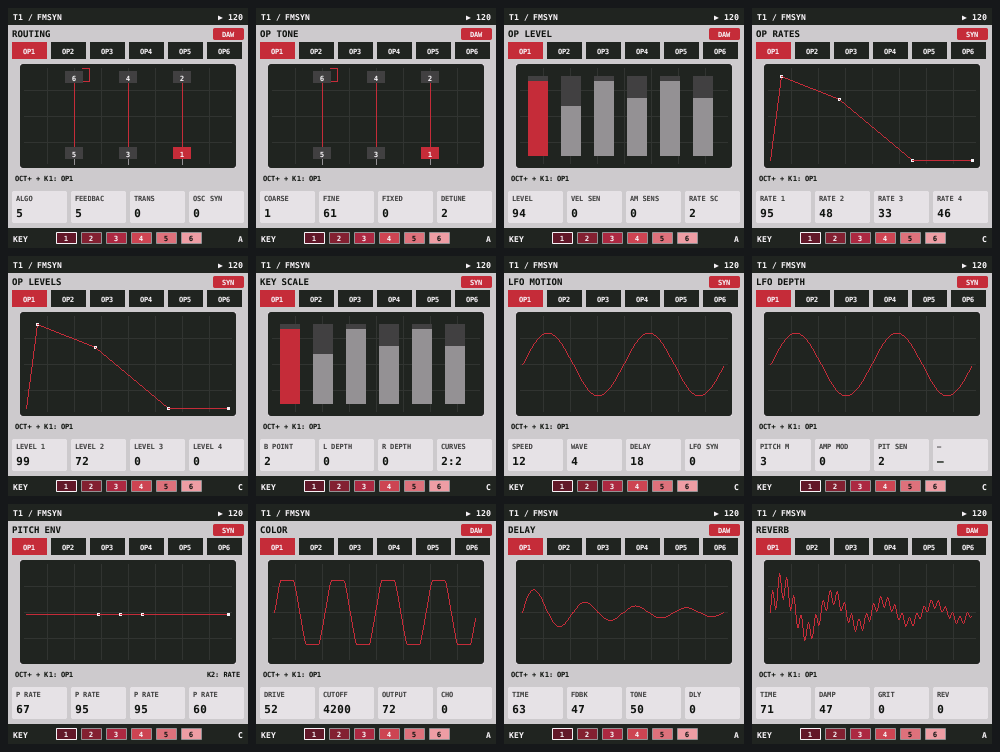

# FM SYN: die FM6-Sound-Seiten

Release 1.1.0.0 (16.11.2026). Diese Seite ergänzt die Anleitung, die 1.0.0.0 beschreibt.

## Was FM6 ist

FM SYN ist ein FM-Synth mit sechs Operatoren. Ein **Operator** ist eine Sinuswelle mit eigenem Pegel, eigener Stimmung
und eigener Hüllkurve. Der **Algorithmus** legt fest, welche Operatoren du hörst (die Carrier, die untere Reihe im
ROUTING-Bild) und welche den Klang eines anderen verändern (die Modulatoren darüber). In jedem Algorithmus kann ein
Operator auf sich selbst zurückwirken. Die Spuren teilen sich sechzehn FM-Stimmen; eine Spur spielt bis zu sechs.

Die 22 Keys, Bells, Orgeln, Pads und Leads der Bänke A–E sind FM6-Sounds. Du lädst sie wie bisher über **BANKS**.

## Die Seiten

Eine Spur mit FM6-Sound hat zwölf Seiten, je drei auf vier Tasten. Dieselbe Taste noch einmal drücken blättert weiter.

| Taste | Seite | K1 | K2 | K3 | K4 |
| --- | --- | --- | --- | --- | --- |
| **FX** | ROUTING | ALGO 1–32 | FEEDBACK 0–7 | TRANS, in Halbtönen | OSC SYN: jede Note startet die Wellen neu |
| | OP TONE | COARSE: das Verhältnis zur Note | FINE | FIXED: feste Frequenz statt Verhältnis | DETUNE |
| | OP LEVEL | LEVEL | VEL SEN: wie stark der Anschlag zählt | AM SENS: wie stark der LFO den Pegel bewegt | RATE SC: schnellere Hüllkurven bei hohen Noten |
| **SCL** | OP RATES | RATE 1 | RATE 2 | RATE 3 | RATE 4 (nach dem Loslassen) |
| | OP LEVELS | LEVEL 1 | LEVEL 2 | LEVEL 3 (gehalten) | LEVEL 4 (Ende und Anfang) |
| | KEY SCALE | B POINT: die Note, um die sich die Skalierung dreht | L DEPTH | R DEPTH | CURVES, links : rechts |
| **ENV** | LFO MOTION | SPEED | WAVE | DELAY | LFO SYN: jede Note startet den LFO neu |
| | LFO DEPTH | PITCH MOD | AMP MOD | PIT SEN | |
| | PITCH ENV | vier Raten oder vier Pegel | | | |
| **LFO** | COLOR | DRIVE | CUTOFF, in Hz | OUTPUT | CHO: der Chorus-Send |
| | DELAY | TIME | FDBK | TONE | DLY: der Send dieser Spur |
| | REVERB | TIME | DAMP | GRIT | REV: der Send dieser Spur |

- **Operator wählen:** **OCT+** halten und **K1** drehen, auf jeder der zwölf Seiten. Die Reihe OP1–OP6 oben zeigt ihn,
  und die Operator-Seiten bearbeiten dann diesen. Die Oktave ändert sich beim Loslassen nicht.
- **PITCH ENV:** **OCT+** halten und **K2** nach rechts drehen für die vier Pegel, nach links für die vier Raten.
- **Eine gehaltene Note folgt den Reglern:** Taste halten und drehen; die Note muss nicht neu gespielt werden.
- TIME, FDBK und TONE des Delays sowie TIME, DAMP und GRIT des Reverbs gelten für alle Spuren. Die Sends gehören der Spur.

## Undo

**OCT-** zweimal schnell tippen. Die letzte Reglerbewegung wird zurückgenommen; war das Letzte das Laden eines Sounds
oder Patterns, dann dieses. Auf dem Bildschirm steht `UNDO` oder `NOTHING TO UNDO`. Es ist ein Schritt, kein Verlauf.

## Speichern

Ein FM6-Sound wird mit der Jam gespeichert. Die sichert der FM-1 von selbst, kurz nachdem du ihn nicht mehr berührst,
und holt sie beim Einschalten zurück. Solange eine Spur einen FM6-Sound spielt, speichern und laden die eigenen
Sound-Plätze und die Kits nicht: Auf dem Bildschirm steht `FM6: USE PROJECT SAVE`. Eine Jam aus 1.0.0.0 lädt 1.1.0.0
nicht.

## Am Computer

[Trap Station Desktop](https://github.com/sog-maker/trapstation-desktop) zeigt dieselben zwölf Seiten mit allen Werten auf
einmal, spielt den Sound über die Engine der Firmware selbst, liest die FM6-Sounds deiner Spuren vom FM-1 und
importiert und exportiert DX7-Stimmen (`.syx`).
