# TRAPSTATION - Anleitung und Designatlas

Bedienstand 15.11.2026, Release 1.0.0.0. Neu gegenüber 0.9.9.7: OCT+ + K1 wählt in Piano Roll und Quick Fill wieder CHORD oder SINGLE; der Szenenwechsel zeigt kein Meldungsfenster; der Installer kann den Werkszustand herstellen. Am Computer heißt das Gerät TRAPSTATION FM-1.

## Installation

### 1. Vorbereiten

Ein USB-Datenkabel und Chrome oder Edge verwenden. Andere Musikprogramme schließen, die den FM-1 nutzen. Die zur Firmware gehörige Release-Version und Hinweise prüfen.

### 2. Sichern

Im Installer zuerst eine Sicherung vom FM-1 speichern, einschließlich Samples. Die Datei auf dem Computer behalten. Projekte, Sounds und die letzte Session vor dem Update kontrollieren.

### 3. Installieren

Im Installer das Gerät verbinden, das passende Trapstation-Paket prüfen und die Installation selbst starten. Während des Schreibens USB verbunden lassen. Der Installer meldet das Ergebnis; diese Dokumentationsvorschau installiert nichts.

### 4. Starten und prüfen

Nach dem Neustart folgen Pad-Logo und Studio Console. NEW erstellt ein Projekt, LOAD lädt ein Kit, RESUME setzt die letzte Session fort. Beim CLOCK-K4 lässt sich der zweite Kern einschalten; danach neu starten.

### 5. Wiederherstellen

Eine gespeicherte Trapstation-Sicherung über den Restore-Bereich einlesen und die angezeigten Inhalte prüfen. Werkszustand: „Sichern und Werkszustand herstellen“ löscht eigene Sounds, Kits, Samples und die letzte Jam (vorher gesichert); die Einstellungen bleiben.

## Schnellstart und Orientierung

### Starten und Projekt wählen

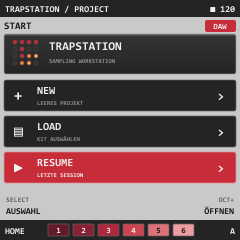

| Control | Funktion |
|---|---|
| NEW | Neues Projekt |
| LOAD | Kit auswählen |
| RESUME | Letzte Session |

SELECT wählt den Eintrag, OCT+ öffnet ihn. Finaler Start: START-B-BOOT mit Pad-Logo, danach Studio Console. Die Bankstart-Animation folgt nur auf NEW.

### Seiten und Presets finden

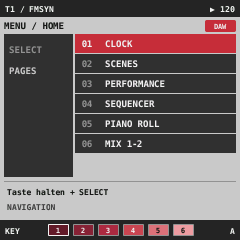

| Control | Funktion |
|---|---|
| TASTE + SELECT | Seitenmenü |
| HOME + PRESETS | Preset-Browser |
| ALGORITHM | Sound im Browser |
| LOSLASSEN | Sound übernehmen |

Seitentaste halten und SELECT drehen. Ein kurzer Druck kehrt zur letzten Seite des Reiters zurück; erneuter Druck blättert weiter. PRESETS ohne HOME wählt die Machine.

### Bank und Sound laden

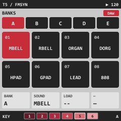

| Control | Funktion |
|---|---|
| K1 | BANK wählen |
| K2 | SOUND wählen |
| K3 | LOAD ausführen |
| K4 | frei |

Erst Bank und Sound suchen, dann mit K3 auf die gewählte Spur laden. Die gemeinsame BANKS-Seite gilt für alle Bänke; beim Browsen wird noch nichts geladen.

### Spuren, Bars und Transport

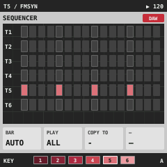

| Control | Funktion |
|---|---|
| ALGORITHM | Spur 1-6, dann FX |
| PLAY / REC | Transport / Aufnahme |
| SEQ K2 PLAY | ALL oder Bar 1-4 |
| SEQ K3 COPY TO | Ziel-Bar wählen |

Im SEQUENCER zeigt K1 BAR den Takt. K2 PLAY wiederholt eine Bar live. K3 COPY TO kopiert die gespielte, sonst die angezeigte Bar auf die gewählte Ziel-Bar: 0,6 s nach dem letzten Dreh, für alle Spuren. Steps werden kopiert, Parameter-Locks nicht. Kürzere Spuren werden bei Bedarf verlängert.

### Sequencer und Piano Roll

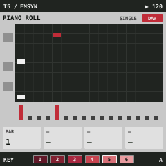

| Control | Funktion |
|---|---|
| SEQ KURZ | KEY / SEQ wechseln |
| OCT+ + K1 | rechts SINGLE, links CHORD |
| K1 PICK | nächster Akkord / nächste Note |
| K2 / K3 / K4 | Position / Tonhöhe / Länge |

OCT+ + K1 legt fest, was K1 auswählt: rechts SINGLE (einzelne Noten), links CHORD (ganze Akkorde); oben rechts steht der Modus. K1 springt dann von Akkord zu Akkord bzw. von Note zu Note. SELECT wählt den Takt. Die linke Tastatur leuchtet mit gespielten Noten rot; Noten können über Taktgrenzen verschoben werden.

### Sound oder Kit speichern

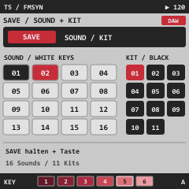

| Control | Funktion |
|---|---|
| SAVE HALTEN | Speichern |
| SAVE KURZ | Ladeauswahl |
| WEISS 1-16 | Sound-Slots |
| SCHWARZ 1-11 | Kit-Slots |

Zum Speichern SAVE halten + Slot-Taste. Zum Laden SAVE kurz antippen und Slot-Taste drücken. Erneutes SAVE oder eine Seitentaste schließt das Fenster. Sound- und Kit-Plätze sind getrennt.

## Sampler und Noten bearbeiten

### OSC 1 mit drei Regler-Sätzen

| Control | Funktion |
|---|---|
| OCT+ + K1 | Nächster / voriger Satz |

1: PITCH / STRCH / START / LEN
2: MODE / SLOT / LOFI / LEVEL
3: GATE / SCRUB / frei / frei

Gleiche Seite, neue Reglerkarten. Beim Seitenwechsel beginnt OSC 1 wieder mit Satz 1.

### Sample und Abspielart wählen

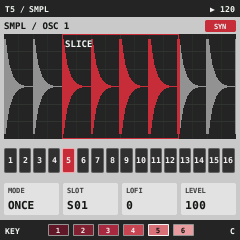

| Control | Funktion |
|---|---|
| K1 | MODE |
| K2 | SLOT / Sample |
| K3 | LOFI |
| K4 | LEVEL |

Satz 2 aktiv: Die MODE-Karte zeigt ONCE, LOOP, PING oder REV. In Satz 1 bearbeiten PITCH/STRCH die Tonhöhe und Streckung; START/LEN legen das Abspielfenster fest.

### MODE vorübergehend verändern

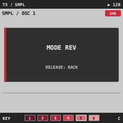

| Control | Funktion |
|---|---|
| OCT+ HALTEN | Modifier aktiv |
| K2 DREHEN | MODE wählen |
| LOSLASSEN | Voriger MODE zurück |

Das Banner zeigt die temporäre Abspielart, z. B. MODE REV. Das funktioniert in jedem Regler-Satz. K1 wechselt die Karten; K2 mit OCT+ verändert den MODE nur solange gehalten.

### SLICE automatisch erzeugen

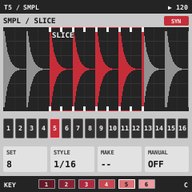

| Control | Funktion |
|---|---|
| K1 SET | 2-16 Slices |
| K2 STYLE | 1/4, 1/8, 1/16 |
| K3 RECHTS | MAKE |
| K4 | MANUAL OFF |

Beispiel: SET 8, STYLE 1/16, MAKE. Weiße Taste n spielt danach Slice n. STYLE rastet die Schnitte ein und kann ihre Anzahl begrenzen. Erst MAKE übernimmt die Vorschau.

### SLICE im Rhythmus eintippen

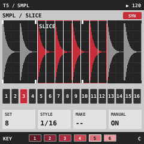

| Control | Funktion |
|---|---|
| K4 ON | MANUAL einschalten |
| WEISS 1 | Sample starten |
| WEISS 2, 3 ... | Schnitte tippen |
| K3 MAKE | Übernehmen |

Während das Sample läuft, setzen die weißen Tasten Schnittmarken. Nach MAKE werden die Slices spielbar. K3 links: SLICES OFF. Die Zuordnung wird mit dem Last Jam gespeichert, nicht im einzelnen Sound-Slot.

### Quick Fill und Einzelnoten

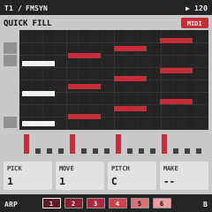

| Control | Funktion |
|---|---|
| SELECT | Fill-Typ wählen |
| K1 / K2 | Auswahl / Position |
| K3 | Tonhöhe |
| K4 | MAKE |

Quick Fill: OCT+ + K1 wählt wie in der Piano Roll CHORD oder SINGLE, K1 dann den Akkord bzw. die Note; K2 verschiebt, K3 ändert die Tonhöhe. K4 erzeugt den Fill im sichtbaren Takt. Piano Roll: K4 bearbeitet stattdessen die Länge. Positionen können über Taktgrenzen wechseln; Platzkonflikte werden umgeordnet.

## Synths und musikalische Werkzeuge

### Hüllkurven und Filter formen

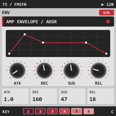

| Control | Funktion |
|---|---|
| ENV | AMP-Hüllkurve |
| SCL | FILTER / FILTER ENV |
| LFO | Modulation / SYNC |
| K1-K4 | Werte unter dem Display |

ATK, DEC, SUS und REL formen den Verlauf. ENV DEST wählt Ziel und Stärke der Hüllkurve; LFO wählt Welle, Ziel und Betrag. Die gezeichneten Kurven helfen beim Einordnen der Werte.

### FM, Mono, Drums und 808

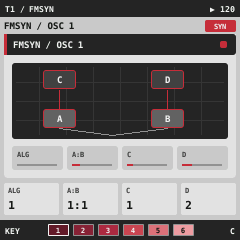

| Control | Funktion |
|---|---|
| OSC 1 / OSC 2 | Klangkern der Machine |
| MOD C / MOD D | FM-Modulatoren |
| TUNE | Detune / Pitch |
| COLOR / CRUSH | Klangfarbe |

Die sichtbaren Seiten passen zur gewählten Machine. FM SYN bietet Algorithmus und Operatoren, MONO Oszillatoren und Sub, 8BAS die 808-Hüllkurven. Vier Regler entsprechen stets den vier Karten.

### Vier Generatoren mit Gamble

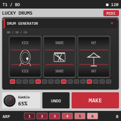

| Control | Funktion |
|---|---|
| K1 GAMBLE | Zufallsgrad 0-100 |
| K2 | frei |
| K3 UNDO | Vorheriges Ergebnis |
| K4 RECHTS | MAKE anfordern |

Lucky Drums / Ace Hats / Low Roller / Golden Chords.
STOP verwenden, MAKE wählen, mit OCT+ bestätigen. Jeder Generator zeigt seine eigene Animation. Geeignete Drum-, HiHat-, Bass- oder Synth-Spur wählen.

### Scale, Chord und Arp

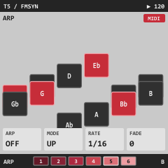

| Control | Funktion |
|---|---|
| SCALE | ROOT / SCL / QNT / GLD |
| CHORD | CHRD / VOIC / ROOT / SCL |
| ARP | ARP / MODE / RATE / FADE |

Grundton und Tonleiter zuerst festlegen. CHORD bestimmt Akkordtyp und Voicing. ARP bestimmt Spielrichtung und Teilung. Die ARP-Taste halten + SELECT erreicht alle Seiten bis Euclid.

### Akkordfolgen und Varianten

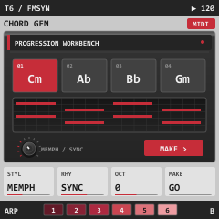

| Control | Funktion |
|---|---|
| CHORD GEN K1 | STYL |
| K2 / K3 | RHY / OCT |
| K4 | MAKE |

CHORD GEN ist der Progression-Editor und bleibt getrennt von Golden Chords. CHORD VAR: K1 VAR, K2 LIVE, K3 UNDO, K4 MAKE. Die Gegenüberstellung SOURCE / VARIANT zeigt das Ergebnis.

### Euclid als Rhythmus-Werkzeug

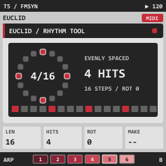

| Control | Funktion |
|---|---|
| K1 LEN | Länge |
| K2 HITS | Trefferzahl |
| K3 ROT | Rotation |
| K4 MAKE | Erzeugen |

Treffer werden über die gewählte Länge verteilt. Mit ROT verschiebst du den Startpunkt. Ring und Step-Leiste zeigen die Verteilung. Die Bedienung bleibt innerhalb der gemeinsamen Generator-Familie.

## Mix, Scenes und Effekte spielen

### Mixer immer paarweise

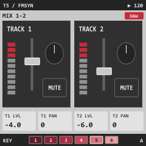

| Control | Funktion |
|---|---|
| SELECT | 1-2 / 3-4 / 5-6 |
| K1 / K2 | Level / Pan, erste Spur |
| K3 / K4 | Level / Pan, zweite Spur |

Die drei Mixeransichten verwenden denselben Aufbau. Spurnummer und roter Track-Farbton zeigen die Zuordnung. Pegel und Panorama gelten für das gerade angezeigte Paar.

### Scenes vorbereiten und laden

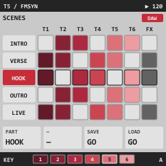

| Control | Funktion |
|---|---|
| K1 PART | Szene wählen |
| K3 SAVE | Spurkombination merken |
| K4 LOAD | Szene anwenden |

SCENES speichert die aktive Mute-Kombination. Bei PLAY wird LOAD am nächsten Taktwechsel aktiv; bei STOP sofort. LIVE zeigt die aktuelle Kombination der Spuren und FX. Die schwarzen Tasten zeigen die kommende Szene sofort; kein Meldungsfenster verdeckt die Seite.

### PERFORMANCE: Hold und Latch

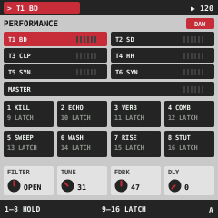

| Control | Funktion |
|---|---|
| SCHWARZ 1-6 | Spuren direkt muten |
| OCT+ + SCHWARZ | Effektkanal 1-6 wählen |
| SCHWARZ 7 | MASTER als Effektziel |
| SCHWARZ 8-11 | Bar 1-4; erneut = ALL |

Weiß 1-8: Effekte halten; 9-16: einrasten. K1 FILTER / K2 TUNE / K3 FDBK / K4 DLY.
1 KILL · 2 ECHO · 3 VERB · 4 COMB
5 SWEEP · 6 WASH · 7 RISE · 8 STUT
Alle sechs Spuren bleiben sichtbar. Beim Verlassen der Seite enden die aktiven Effekte.

### Delay, Reverb und Sends

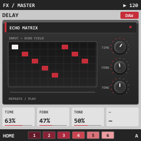

| Control | Funktion |
|---|---|
| DELAY | TIME / FDBK / TONE |
| REVERB | TIME / DAMP / GRIT |
| SENDS | DLY / REV je Spur |

Die Spur-Sends speisen die gemeinsamen Effekte. Auf der FX-Spur bearbeitest du Delay und Reverb selbst. DLY-A zeigt Echos in der Matrix; REV-A zeigt den Reflexionsraum.

### Tape, VHS und Vinyl

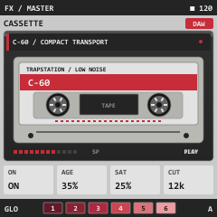

| Control | Funktion |
|---|---|
| TAPE C-60 | ON / AGE / SAT / CUT |
| VHS E-180 | WOW / RATE / FLUT / RATE |
| VINYL | HISS / DUST / CRKL / WEAR |

Die Reihenfolge entspricht K1 bis K4. Bei PLAY bewegen sich Bandspulen beziehungsweise Platte; bei STOP ruht die Mechanik. Beim Tape aktiviert ON den Effekt.

### Clock, DJ, AMP und Comb

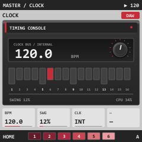

| Control | Funktion |
|---|---|
| CLOCK | K1 BPM / K2 SWG / K3 CLK |
| AMP | AMP / PAN |
| DJ | K1: Tiefpass / Hochpass |
| COMB | MIX / TUNE / FDBK / DAMP |

CLK wählt INT, USB oder TRS. Die 16 Clock-Blöcke laufen bei PLAY von links nach rechts. K4 zeigt die CPU-Last und schaltet den zweiten Kern: rechts ON, links OFF; danach neu starten. DJ filtert von der offenen Mitte zu Tiefpass/Hochpass. AMP regelt Master-Pegel und Panorama.

## Design atlas

Die 154 Ansichten sind freigegebene Designreferenzen, keine 154 unabhängigen Funktionen. Aktuelle Bedienung siehe oben.

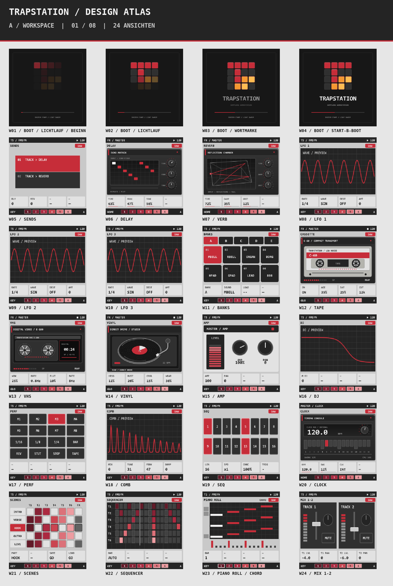

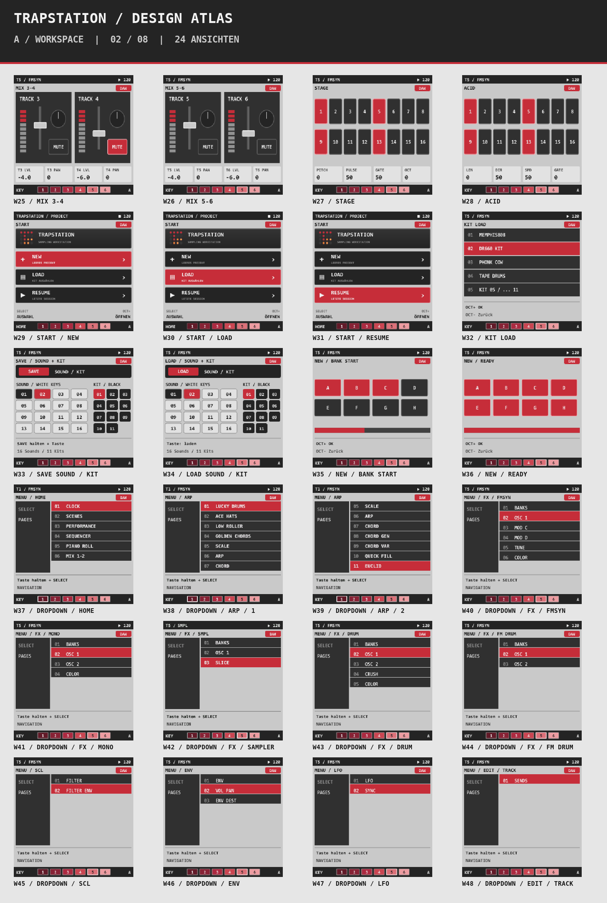

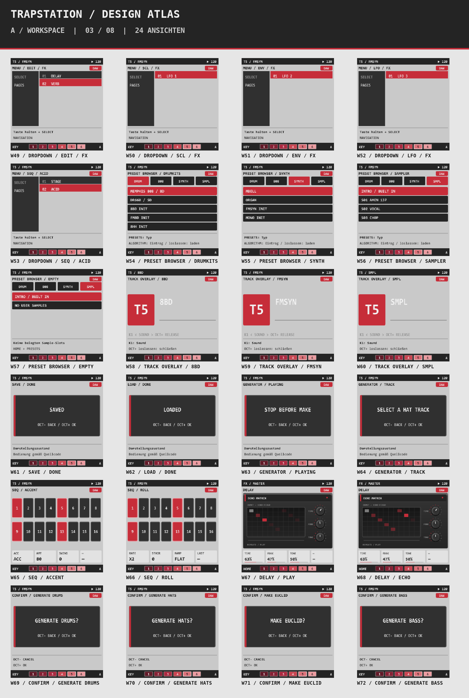

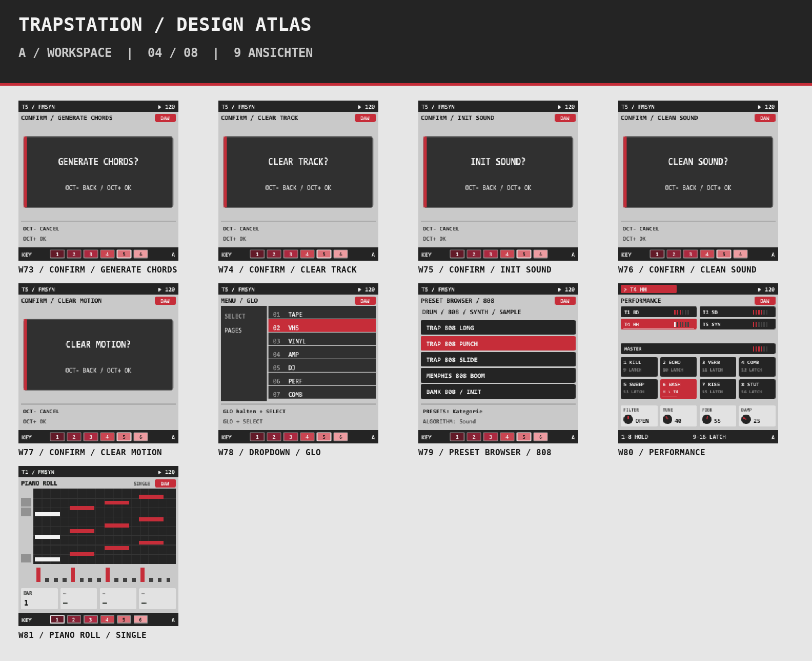

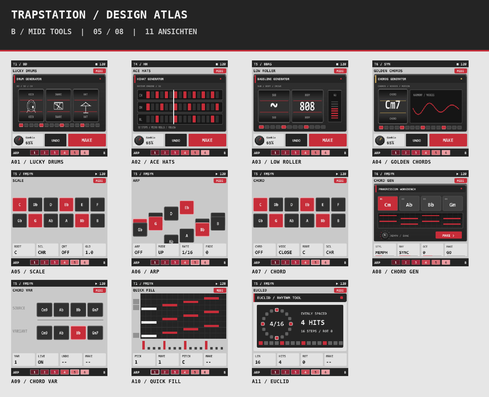

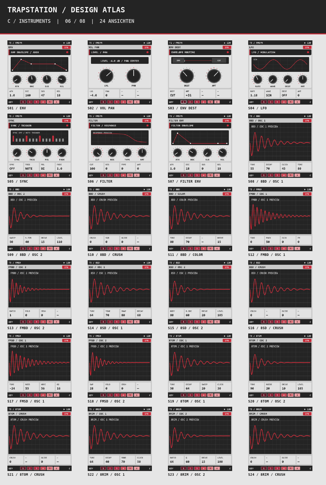

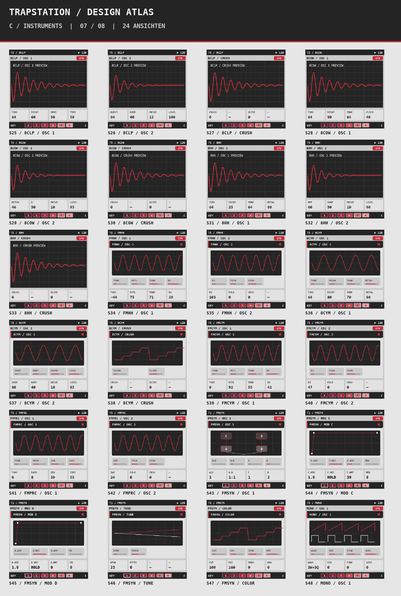

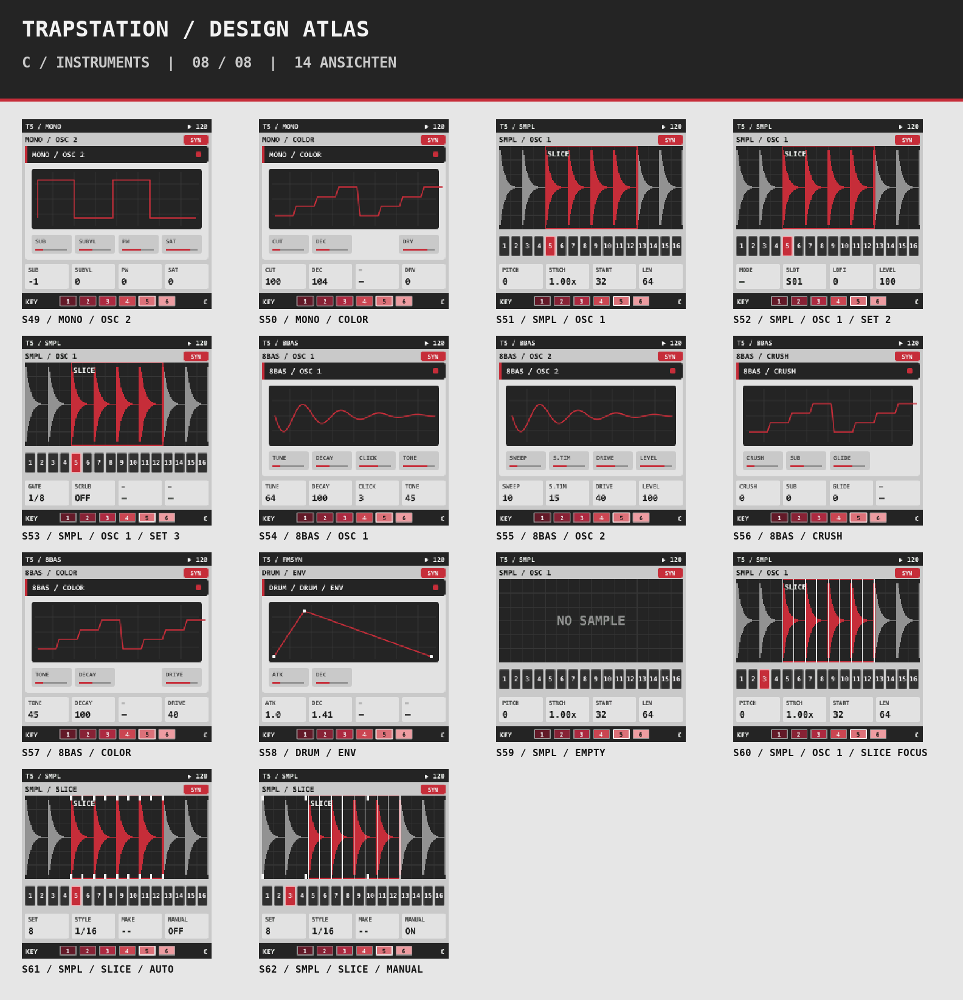
