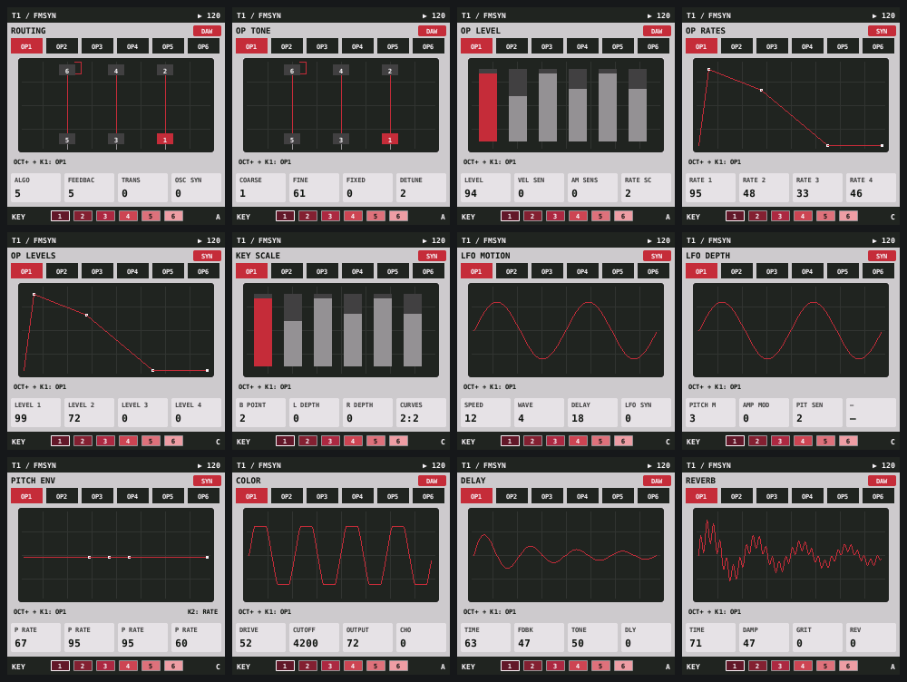

# FM SYN: the FM6 sound pages

Release 1.1.0.0 (16 November 2026). This page adds to the user guide, which describes 1.0.0.0.

## What FM6 is

FM SYN is a six-operator FM synth. An **operator** is a sine wave with its own level, tuning and envelope. The
**algorithm** decides which operators you hear (the carriers, the bottom row of the ROUTING picture) and which ones
change the tone of another (the modulators above them). One operator of every algorithm can feed back into itself.
The tracks share sixteen FM voices; one track plays up to six.

The 22 keys, bells, organs, pads and leads of banks A–E are FM6 sounds. Load one from **BANKS** as before.

## The pages

A track with an FM6 sound has twelve pages, three on each of four buttons. Press a button again for its next page.

| Button | Page | K1 | K2 | K3 | K4 |
| --- | --- | --- | --- | --- | --- |
| **FX** | ROUTING | ALGO 1–32 | FEEDBACK 0–7 | TRANS, in semitones | OSC SYN: every note starts the waves anew |
| | OP TONE | COARSE: the ratio to the note | FINE | FIXED: a fixed frequency instead of a ratio | DETUNE |
| | OP LEVEL | LEVEL | VEL SEN: how much the velocity counts | AM SENS: how much the LFO moves the level | RATE SC: faster envelopes on high notes |
| **SCL** | OP RATES | RATE 1 | RATE 2 | RATE 3 | RATE 4 (after the key is let go) |
| | OP LEVELS | LEVEL 1 | LEVEL 2 | LEVEL 3 (held) | LEVEL 4 (the end, and the start) |
| | KEY SCALE | B POINT: the note the scaling turns around | L DEPTH | R DEPTH | CURVES, left : right |
| **ENV** | LFO MOTION | SPEED | WAVE | DELAY | LFO SYN: every note starts the LFO anew |
| | LFO DEPTH | PITCH MOD | AMP MOD | PIT SEN | |
| | PITCH ENV | four rates, or four levels | | | |
| **LFO** | COLOR | DRIVE | CUTOFF, in Hz | OUTPUT | CHO: the chorus send |
| | DELAY | TIME | FDBK | TONE | DLY: this track's send |
| | REVERB | TIME | DAMP | GRIT | REV: this track's send |

- **Choose the operator:** hold **OCT+** and turn **K1**, on any of the twelve pages. The row OP1–OP6 at the top shows
  it, and the operator pages then edit that one. The octave does not change when you let go.
- **PITCH ENV:** hold **OCT+** and turn **K2** to the right for the four levels, to the left for the four rates.
- **A held note follows the knobs:** hold a key and turn; you do not have to play the note again.
- TIME, FDBK and TONE of the delay and TIME, DAMP and GRIT of the reverb belong to all tracks. The sends are the track's.

## Undo

Tap **OCT-** twice quickly. The last knob move is taken back; if the last thing was loading a sound or a pattern, that
is taken back instead. The screen says `UNDO`, or `NOTHING TO UNDO`. It is one step, not a history.

## Saving

An FM6 sound is kept with the jam, which the FM-1 saves by itself a moment after you stop touching it, and brings back
at power-on. While a track plays an FM6 sound, the user sound slots and the kits do not save or load: the screen says
`FM6: USE PROJECT SAVE`. A jam made with 1.0.0.0 is not loaded by 1.1.0.0.

## On the computer

[Trap Station Desktop](https://github.com/sog-maker/trapstation-desktop) shows the same twelve pages with every value at
once, plays the sound through the firmware's own engine, reads the FM6 sounds of your tracks from the FM-1, and imports
and exports DX7 voices (`.syx`).
