# TRAPSTATION - User guide and design atlas

Controls baseline: 15 November 2026, release 1.0.0.0. New since 0.9.9.7: OCT+ + K1 chooses CHORD or SINGLE again in Piano Roll and Quick Fill; changing scenes shows no message window; the installer can reset to the factory state. On the computer the device shows up as TRAPSTATION FM-1.

## Installation

### 1. Prepare

Use a USB data cable and Chrome or Edge. Close other music applications using the FM-1. Check the release version and notes that belong to the firmware package.

### 2. Back up

Use the installer to save a backup from the FM-1 first, including samples. Keep the file on your computer. Check your sounds, kits and last session before updating.

### 3. Install

Connect the device in the installer, check the intended Trapstation package and start installation yourself. Keep USB connected while it writes. The installer reports the result; this documentation preview does not install anything.

### 4. Start and check

After restart, the pad logo leads to the Studio Console. NEW creates a project, LOAD loads a kit, and RESUME continues the last session. CLOCK K4 can enable the second core; restart afterwards.

### 5. Restore

Open a saved Trapstation backup in the Restore section and check the listed contents. Factory state: Back up and reset to factory state deletes your own sounds, kits, samples and last jam (backed up first); the settings stay.

## Quick start and navigation

### Start and choose a project

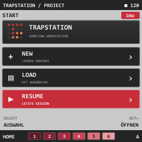

| Control | Function |
|---|---|
| NEW | Start a new project |
| LOAD | Choose a kit |
| RESUME | Continue the last session |

SELECT chooses an entry; OCT+ opens it. The final startup uses the START-B-BOOT pad logo followed by the Studio Console. The bank-start animation runs only after NEW.

### Find pages and presets

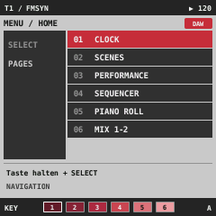

| Control | Function |
|---|---|
| BUTTON + SELECT | Open the page menu |
| HOME + PRESETS | Open the preset browser |
| ALGORITHM | Select a browser sound |
| RELEASE HOME | Load the selected sound |

Hold a page button and turn SELECT. A short press returns to the last page of that group; pressing again cycles through its pages. PRESETS without HOME selects the Machine.

### Load a bank sound

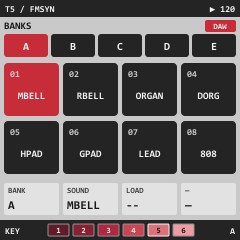

| Control | Function |
|---|---|
| K1 | Select BANK |
| K2 | Select SOUND |
| K3 | Execute LOAD |
| K4 | Unused |

Choose a bank and sound, then use K3 to load it onto the selected track. BANKS is the shared browser for every bank; browsing alone does not load a sound.

### Tracks, bars and transport

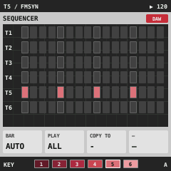

| Control | Function |
|---|---|
| ALGORITHM | Track 1-6, then FX |
| PLAY / REC | Transport / recording |
| SEQ K2 PLAY | ALL or bar 1-4 |
| SEQ K3 COPY TO | Choose the target bar |

In SEQUENCER, K1 BAR chooses the displayed bar. K2 PLAY repeats a bar live. K3 COPY TO copies the playing bar, otherwise the displayed bar, to the target: 0.6 s after the last turn, across all tracks. Steps are copied, parameter locks are not. Shorter tracks extend when needed.

### Sequencer and Piano Roll

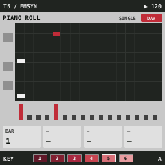

| Control | Function |
|---|---|
| SEQ TAP | Switch KEY / SEQ |
| OCT+ + K1 | Right SINGLE, left CHORD |
| K1 PICK | Next chord / next note |
| K2 / K3 / K4 | Position / pitch / length |

OCT+ + K1 sets what K1 picks: right SINGLE (individual notes), left CHORD (whole chords); the mode is shown at the top right. K1 then steps from chord to chord or from note to note. SELECT chooses the bar. The keyboard at the left lights red for sounding notes. Notes can move across bar boundaries.

### Save or load a sound or kit

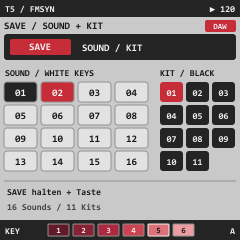

| Control | Function |
|---|---|
| HOLD SAVE | Save mode |
| TAP SAVE | Load selection |
| WHITE 1-16 | Sound slots |
| BLACK 1-11 | Kit slots |

To save, hold SAVE and press a slot key. To load, tap SAVE and press a slot key. SAVE again, or a page button, closes the window. Sounds and kits use separate slots.

## Sampling and note editing

### OSC 1: three knob sets

| Control | Function |
|---|---|
| OCT+ + K1 | Next / previous set |

1: PITCH / STRCH / START / LEN
2: MODE / SLOT / LOFI / LEVEL
3: GATE / SCRUB / unused / unused

One page, three sets of controls. OSC 1 returns to set 1 after leaving and reopening the page.

### Choose a sample and playback mode

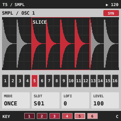

| Control | Function |
|---|---|
| K1 | MODE |
| K2 | SLOT / sample |
| K3 | LOFI |
| K4 | LEVEL |

With set 2 selected: MODE reads ONCE, LOOP, PING or REV. In set 1, PITCH/STRCH set pitch and stretching; START/LEN define the playback window.

### Change MODE temporarily

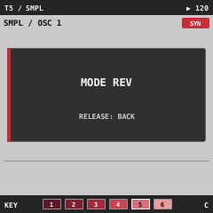

| Control | Function |
|---|---|
| HOLD OCT+ | Activate the modifier |
| TURN K2 | Choose MODE |
| RELEASE OCT+ | Restore the previous MODE |

The banner names the temporary playback mode, for example MODE REV. This works from any knob set. OCT+ + K1 changes the control cards; OCT+ + K2 changes MODE only while held.

### Create automatic slices

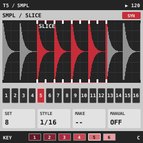

| Control | Function |
|---|---|
| K1 SET | 2-16 slices |
| K2 STYLE | 1/4, 1/8 or 1/16 |
| K3 RIGHT | MAKE |
| K4 | MANUAL OFF |

Example: SET 8, STYLE 1/16, then MAKE. White key n plays slice n. STYLE snaps cuts to its grid and may reduce their count. MAKE applies the preview; choosing values alone does not replace the cuts.

### Tap manual slice points

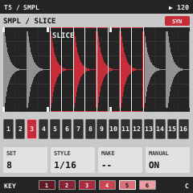

| Control | Function |
|---|---|
| K4 ON | Enable MANUAL |
| WHITE 1 | Start the sample |
| WHITE 2, 3 ... | Tap the next cut points |
| K3 MAKE | Apply the cuts |

While the sample plays, tap the white keys to place cuts. After MAKE, the slices become playable. K3 left: SLICES OFF. The mapping is kept with Last Jam, not in an individual sound slot. In slice playback, black keys are silent.

### Quick Fill and individual notes

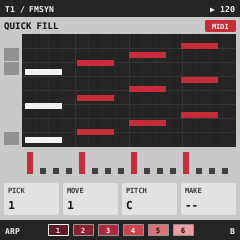

| Control | Function |
|---|---|
| SELECT | Choose the fill type |
| K1 / K2 | Pick / move |
| K3 | Change pitch |
| K4 | MAKE |

Quick Fill: OCT+ + K1 chooses CHORD or SINGLE as in Piano Roll, then K1 picks the chord or note; K2 moves it and K3 changes pitch. K4 creates the fill in the displayed bar. Piano Roll: K4 edits note length instead. Positions can cross bar boundaries; collisions are rearranged.

## Synths and musical tools

### Shape envelopes and filters

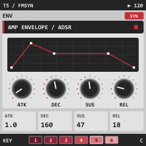

| Control | Function |
|---|---|
| ENV | Amplitude envelope |
| SCL | FILTER / FILTER ENV |
| LFO | Modulation / SYNC |
| K1-K4 | The four value cards |

ATK, DEC, SUS and REL shape the envelope. ENV DEST chooses its destination and amount. LFO chooses waveform, destination and depth. The drawn curves help explain the settings; activity markers show transport, not measured audio.

### FM, Mono, drums and 808

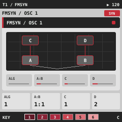

| Control | Function |
|---|---|
| OSC 1 / OSC 2 | The Machine sound engine |
| MOD C / MOD D | FM modulators |
| TUNE | Detune / pitch |
| COLOR / CRUSH | Tone shaping |

The visible pages follow the selected Machine. FM SYN provides algorithms and operators, MONO oscillators and sub, and 8BAS the 808 controls. The four physical knobs follow the four on-screen value cards.

### Four generators, one Gamble knob

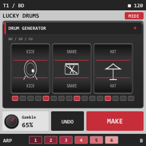

| Control | Function |
|---|---|
| K1 GAMBLE | Randomness: 0-100 |
| K2 | Unused |
| K3 UNDO | Restore the previous result |
| K4 RIGHT | Request MAKE |

Lucky Drums / Ace Hats / Low Roller / Golden Chords.
Stop playback, choose MAKE, then confirm with OCT+. Each generator has its own short animation. Use the appropriate drum, hi-hat, bass or polyphonic synth target. Results remain editable notes.

### Scale, Chord and Arp

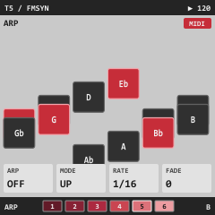

| Control | Function |
|---|---|
| SCALE | ROOT / SCL / QNT / GLD |
| CHORD | CHRD / VOIC / ROOT / SCL |
| ARP | ARP / MODE / RATE / FADE |

Set the root and scale first. CHORD sets chord type and voicing; ARP sets the playing order and rate. Hold ARP and turn SELECT to reach all its pages, through Euclid.

### Chord progressions and variations

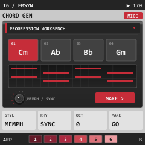

| Control | Function |
|---|---|
| CHORD GEN K1 | STYL |
| K2 / K3 | RHY / OCT |
| K4 | MAKE |

CHORD GEN is the progression tool, separate from Golden Chords. CHORD VAR: K1 VAR, K2 LIVE, K3 UNDO, K4 MAKE. SOURCE / VARIANT compares the original material with the chosen variation.

### Euclid rhythm tool

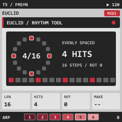

| Control | Function |
|---|---|
| K1 LEN | Pattern length |
| K2 HITS | Number of hits |
| K3 ROT | Rotation |
| K4 MAKE | Generate |

Hits are distributed across the selected length. ROT shifts their starting position. The ring and step strip show the distribution. Euclid stays a dedicated rhythm tool within the same Workstation design family.

## Mix, scenes and performance

### Mix tracks in pairs

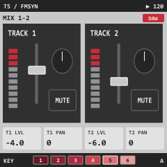

| Control | Function |
|---|---|
| SELECT | 1-2 / 3-4 / 5-6 |
| K1 / K2 | Level / pan, first track |
| K3 / K4 | Level / pan, second track |

All three mixer pages share one layout. Track numbers and consistent red shades identify the channels. Level and pan apply to the displayed pair.

### Store and launch scenes

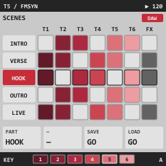

| Control | Function |
|---|---|
| K1 PART | Choose the scene |
| K3 SAVE | Store the track/mute state |
| K4 LOAD | Apply the scene |

SCENES stores the active track/FX mute combination. During PLAY, LOAD applies at the next bar; while stopped, it applies immediately. The black keys show the coming scene at once; no message window covers the page. Scenes do not store separate patterns or form an automatic song chain.

### PERFORMANCE: hold and latch

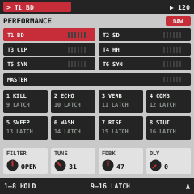

| Control | Function |
|---|---|
| BLACK 1-6 | Mute tracks directly |
| OCT+ + BLACK | Choose effect target 1-6 |
| BLACK 7 | Select MASTER target |
| BLACK 8-11 | Bar 1-4; tap again = ALL |

White 1-8: hold effects; 9-16: latch them. K1 FILTER / K2 TUNE / K3 FDBK / K4 DLY.
1 KILL · 2 ECHO · 3 VERB · 4 COMB
5 SWEEP · 6 WASH · 7 RISE · 8 STUT
All six tracks stay visible. Leaving the page ends its active effects.

### Delay, reverb and sends

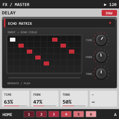

| Control | Function |
|---|---|
| DELAY | TIME / FDBK / TONE |
| REVERB | TIME / DAMP / GRIT |
| SENDS | DLY / REV per track |

Track sends feed the shared effects. Select the FX track to edit delay and reverb themselves. DLY-A displays echoes in a matrix; REV-A displays a reflection chamber. Animated markers indicate playback activity.

### Tape, VHS and vinyl

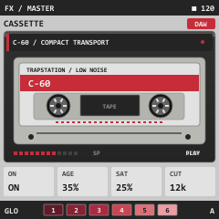

| Control | Function |
|---|---|
| TAPE C-60 | ON / AGE / SAT / CUT |
| VHS E-180 | WOW / RATE / FLUT / RATE |
| VINYL | HISS / DUST / CRKL / WEAR |

These labels follow K1 through K4. The reels or record rotate during PLAY and stop when transport stops. Tape ON enables the tape effect. Each module uses its own mechanical animation.

### Clock, DJ, AMP and Comb

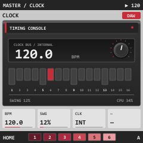

| Control | Function |
|---|---|
| CLOCK | K1 BPM / K2 SWG / K3 CLK |
| AMP | AMP / PAN |
| DJ | K1: low-pass / high-pass |
| COMB | MIX / TUNE / FDBK / DAMP |

CLK selects INT, USB or TRS. During PLAY, the 16 clock blocks move left to right. K4 displays CPU load and switches the second core: right ON, left OFF; restart afterwards. DJ is open at the centre. AMP controls master level and pan.

## Design atlas

The 154 views are approved design references, not 154 independent functions. See the controls above for current behaviour.

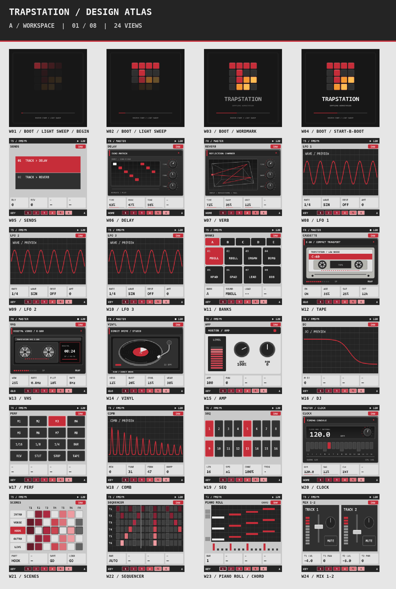

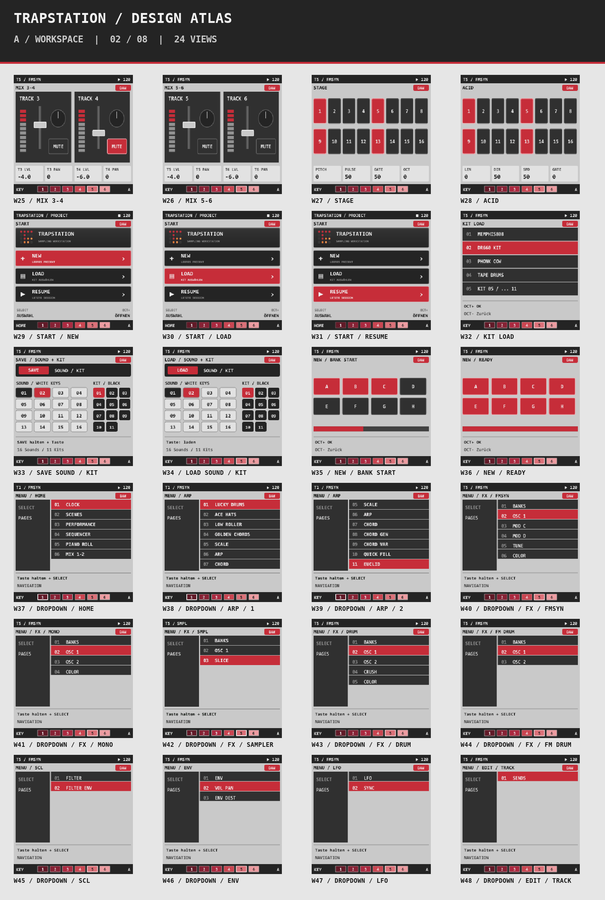

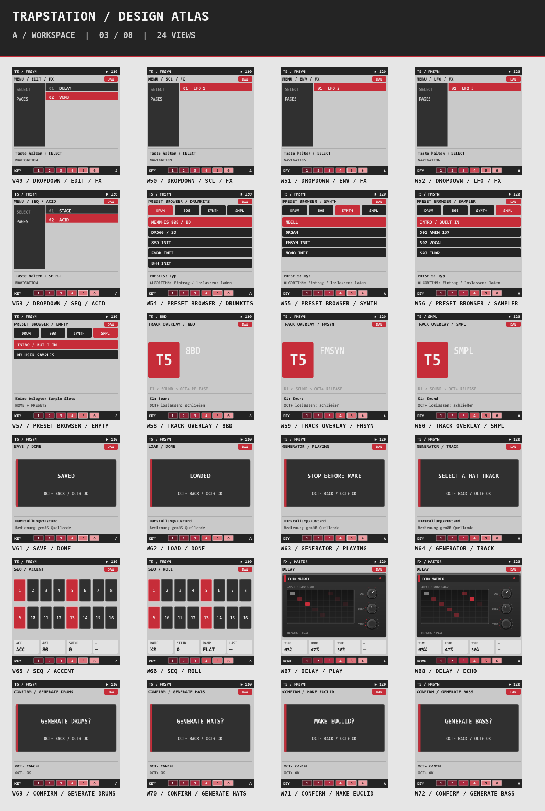

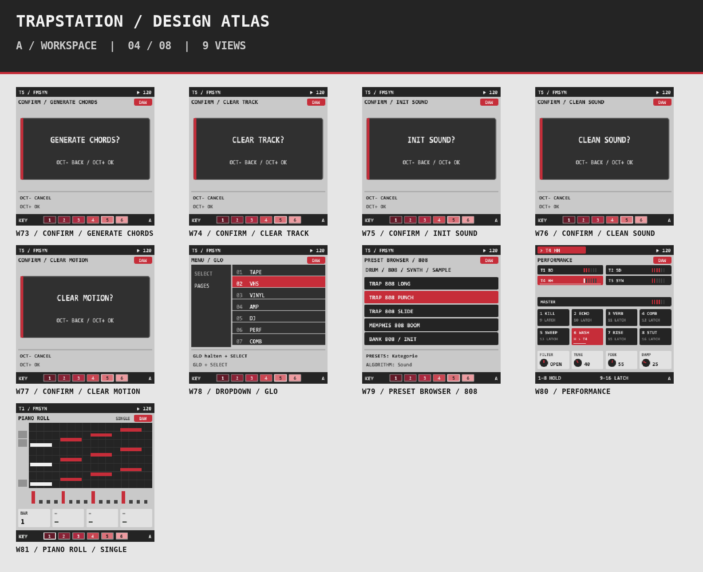

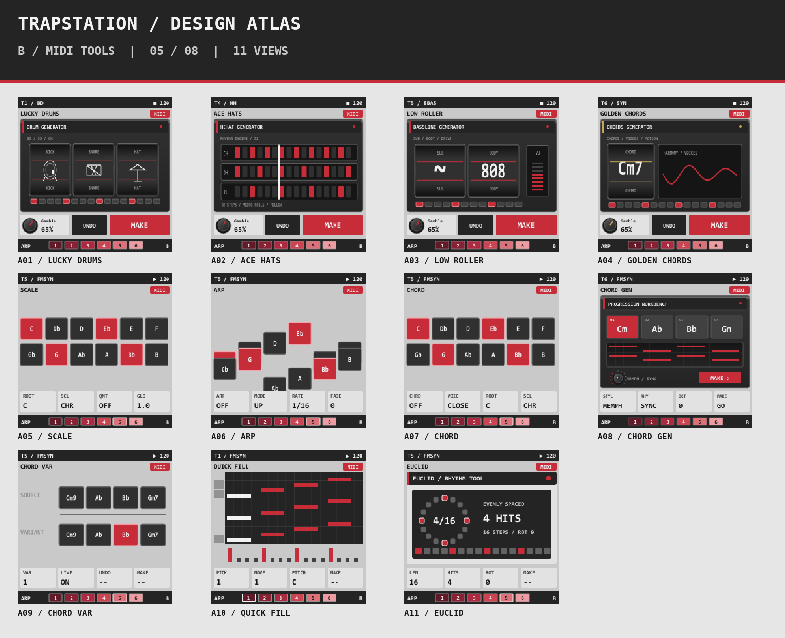

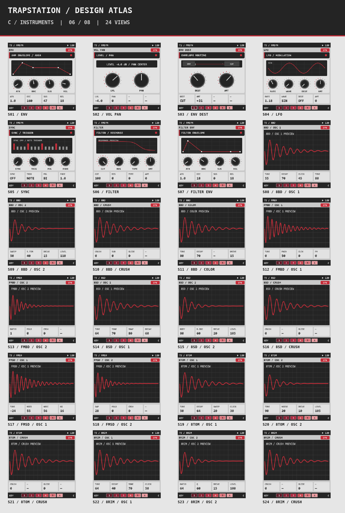

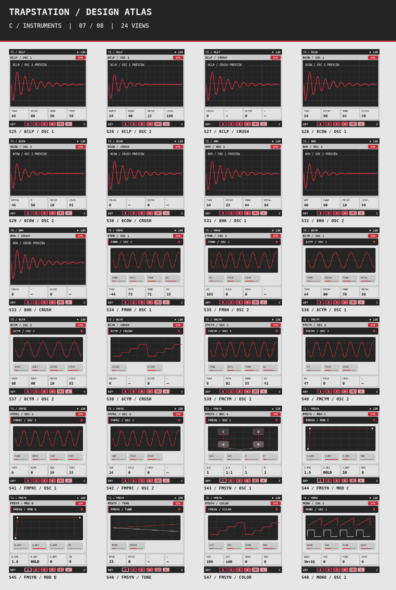

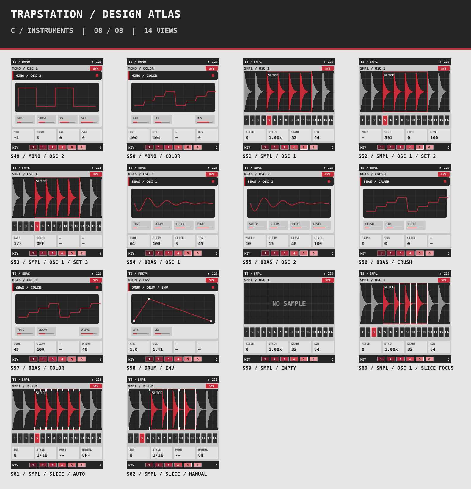
